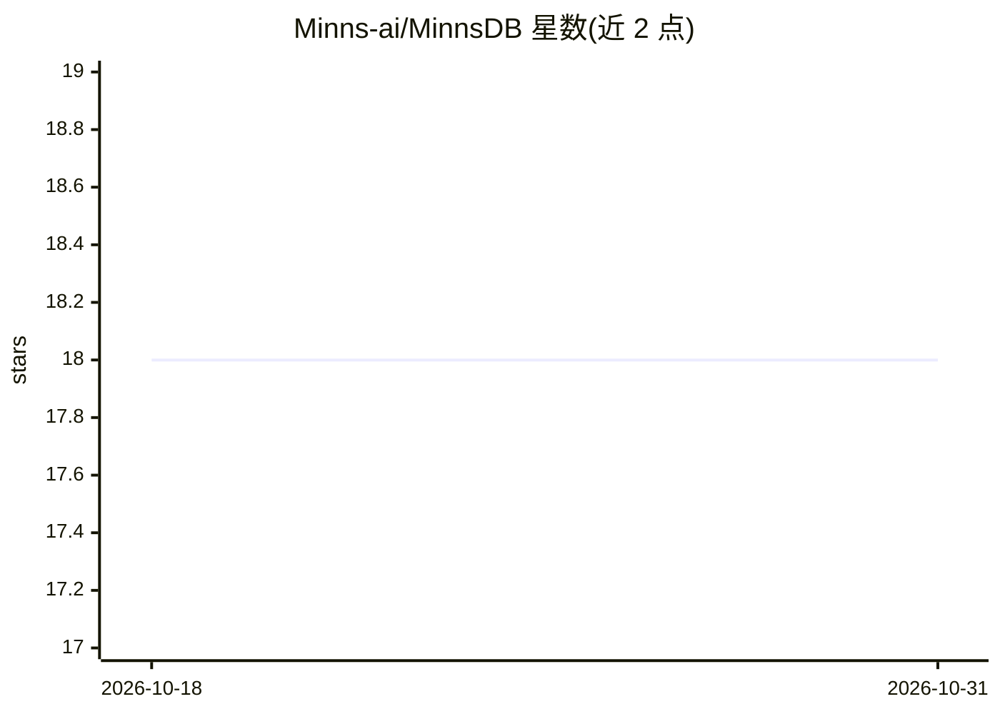

# Minns-ai/MinnsDB

⭐ 18 · Rust · AGPL-3.0 · 推送 2026-10-05 · [GitHub](https://github.com/Minns-ai/MinnsDB) · [官网](https://minns.ai/) · 组织维护

**面向 AI agent 工作负载的数据库：时序知识图谱+表+WASM agent**

单二进制 Rust 数据库，将时序知识图谱、关系表引擎与沙箱化 WASM agent 运行时组合在一起。通过 3 次 LLM 级联调用将聊天记录抽取为实体、关系与时序事实，写入带自动取代与级联失效机制的图谱；统一查询语言 MinnsQL 覆盖图匹配、表 CRUD、时间子句与响应式订阅。WASM 模块可读写表、查图、调外部 API 并按事件触发，受指令计量、内存上限与权限系统约束。运行需连接 Qdrant 向量存储，可选 Docker Compose 部署；提供 LangGraph 集成包。基准分数尚未发布（runner 未开源）。

## 筛选速览

| 维度 | 判定 | 备注 |
|---|---|---|
| AI 角色 | `ai-ecosystem` | LLM/agent 周边工具 |
| 许可风险 | `viral` | AGPL-3.0 |
| 部署形态 | `self-host` | docker 或自建部署 |
| 模型依赖 | — | README 未给出锁定关系 |
| 硬件要求 | — | 无带数字的原话,不猜 |
| 安装摩擦 | `low` | 无编译、无系统依赖或容器化 |
| 成熟度 | `idea` | |

## 能力要点

- 对话摄入：3 次 LLM 级联抽取实体/关系/事实，写入时序图谱
- MinnsQL 统一查询语言：图 MATCH、表 CRUD、AS OF 时间子句、SUBSCRIBE 订阅
- 沙箱 WASM agent 运行时：指令计量、64MB 内存上限、权限声明与用量计量
- 双时态存储：边带 valid_from/valid_until，支持历史时刻查询与级联失效

## 适用场景

- 为 AI agent 提供带时间线的结构化记忆与知识图谱
- 在数据库内运行受控的沙箱化 agent 模块并按事件触发
- 需要审计历史状态变化（双时态）的 agent 应用

## 场景标签

`知识图谱` `Agent 记忆` · 领域:Agent 开发

## 证据(README 行号)

> L23: MinnsDB is a database purpose-built for AI agent workloads. It combines a temporal knowledge graph, a relational ta
> L33: **WASM agents** — upload sandboxed modules that read/write tables, query the graph, call external APIs, and trigger

## 星数曲线

2026-10-18 18 → 2026-10-31 18（+0）

---
*卡片 v1 · prompt 1.4 · 生成 2026-10-29 · 置信度 mid · 依据 README sha `1a7497415d68` · [字段定义](../../DATASET.md)*
