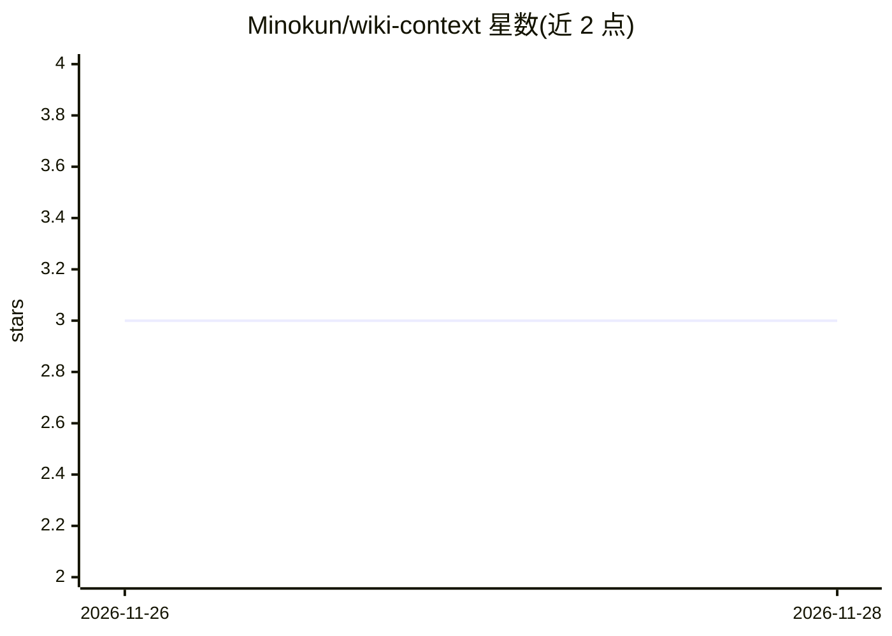

# Minokun/wiki-context

⭐ 3 · Python · MIT · 推送 2026-11-26 · [GitHub](https://github.com/Minokun/wiki-context) · 个人维护 · 中文 README

**为 AI Agent 提供离线编译知识库与零幻觉检索的 MCP 服务**

一个 MCP 服务器形式的确定性上下文引擎：离线阶段做文档抽取（PDF/DOCX/PPTX/XLSX/CSV/MD）、AI 编译跨文档 Wiki 与 SHA-256 新鲜度追踪；在线检索零 LLM 调用、零外部 API、零第三方依赖，用 SQLite FTS5（保留代码型标识符、中文二元分词、表头钉扎窗口）在单次调用内拼装 Wiki 综合与带出处的原文片段，无命中时输出 Missing-Concept 告警，并支持 ACL 继承与凭据清洗。面向已在使用 Claude Code、Cursor 等 Agent 的开发者与团队。

## 筛选速览

| 维度 | 判定 | 备注 |
|---|---|---|
| AI 角色 | `ai-ecosystem` | LLM/agent 周边工具 |
| 许可风险 | `permissive` | MIT |
| 部署形态 | `None` |  |
| 模型依赖 | — | README 未给出锁定关系 |
| 硬件要求 | — | 无带数字的原话,不猜 |
| 安装摩擦 | `low` | 无编译、无系统依赖或容器化 |
| 成熟度 | — | 结构信号不足 |

## 能力要点

- 单次 wiki_context 调用约 2–35 ms，在线零 LLM 调用与零外部 API
- 零第三方 Python 依赖，纯 Python 3.11+ 标准库实现
- SHA-256 source_hashes 追踪 Wiki 页与源文档的新鲜度（stale 徽章与降权）
- PrefixACLPolicy 溯源继承访问控制与敏感凭据清洗

## 适用场景

- 让 Agent 以毫秒级延迟读取工程规范、ADR、SOP 等只读知识
- 在信源中不存在某概念时让 Agent 得到明确告警而非编造答案
- 对含精确编号（RFC 编号、SKU、版本号）与大型表格的知识库做检索
- 在多用户团队环境中按目录前缀控制 Agent 可见的知识范围

## 场景标签

`RAG` · 领域:知识与检索

## 证据(README 行号)

> L10: Protocol: MCP
> L17: - **Decoupled Write vs. Read Paths**: Heavy comprehension happens **offline** (native document extraction + AI-comp
> L65: |**Online Latency & Token Cost**|1–5 s + Embedding/Rerank API calls|15–40 s (3–6 tool calls, ~30k–40k tokens)|**1 t

## 星数曲线

2026-11-26 3 → 2026-11-28 3（+0）

---
*卡片 v1 · prompt 1.4 · 生成 2026-11-26 · 置信度 high · 依据 README sha `953c601e6522` · [字段定义](../../DATASET.md)*
