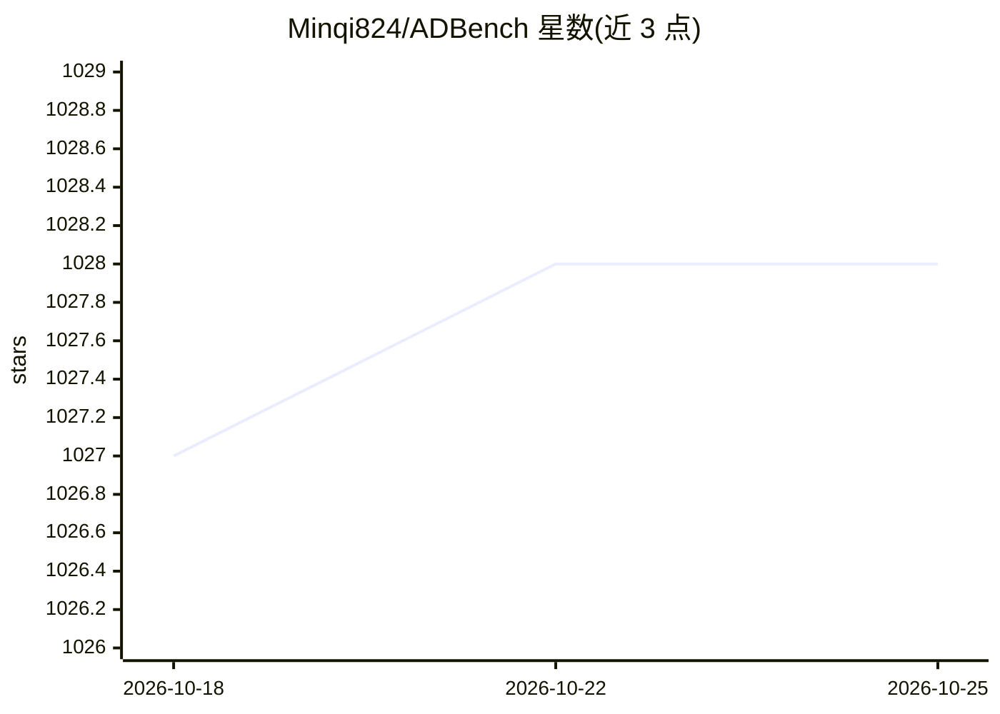

# Minqi824/ADBench

⭐ 1,028 · Python · BSD-2-Clause · 推送 2026-01-08 · [GitHub](https://github.com/Minqi824/ADBench) · 组织维护 · 中文 README

**表格数据异常检测基准：30 种算法在 57 个数据集上的评测**

NeurIPS 2022 论文 ADBench 的官方代码与数据仓库，由上海财经大学与卡内基梅隆大学研究者合作维护。提供 30 种异常检测算法（14 无监督、7 半监督、9 有监督）在 57 个数据集上的统一评测框架，共完成 98,436 组实验，覆盖监督程度、异常类型与数据损坏三个角度。以 pip 包 adbench 提供，通过 RunPipeline 类运行完整实验或在自有数据集上评测自定义算法；数据集从 GitHub 或 jihulab（面向中国大陆用户）下载，NLP/CV 数据使用预训练模型提取嵌入。

## 筛选速览

| 维度 | 判定 | 备注 |
|---|---|---|
| AI 角色 | `ai-ecosystem` | LLM/agent 周边工具 |
| 许可风险 | `permissive` | BSD-2-Clause |
| 部署形态 | `library` | 以包/库形式分发 |
| 模型依赖 | — | README 未给出锁定关系 |
| 硬件要求 | — | 无带数字的原话,不猜 |
| 安装摩擦 | `low` | 无编译、无系统依赖或容器化 |
| 成熟度 | — | 结构信号不足 |

## 能力要点

- 30 种异常检测算法（含深度学习与集成学习方法）的统一 API
- 57 个数据集（47 个真实世界数据集 + 10 个 CV/NLP 新数据集），统一为 .npz 格式
- 支持三种评测角度：监督程度、异常类型、数据损坏下的鲁棒性
- 支持通过 RunPipeline 接入自定义算法与数据集

## 适用场景

- 在统一基准上评测我自己提出的异常检测算法
- 获取多领域异常检测数据集做模型对比实验
- 了解不同监督程度算法在异常检测上的实验结论

## 场景标签

`模型评测` · 领域:评测与运维

## 证据(README 行号)

> L33: ADBench is (to our best knowledge) **the most comprehensive tabular anomaly detection benchmark**, where we analyze
> L78: We present the following example for quickly implementing ADBench in _three different Angles_ illustrated
> L193: ADBench can be served as a great complement to the PyOD toolkit,

## 星数曲线

2026-10-18 1,027 → 2026-10-25 1,028（+1）

---
*卡片 v1 · prompt 1.4 · 生成 2026-10-21 · 置信度 high · 依据 README sha `c321d1c7feba` · [字段定义](../../DATASET.md)*
