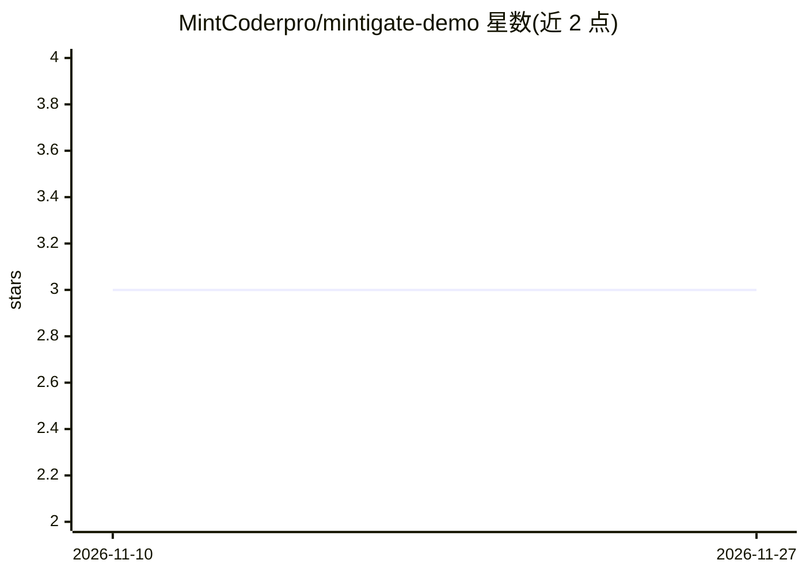

# MintCoderpro/mintigate-demo

⭐ 3 · JavaScript · MIT · 推送 2026-11-07 · [GitHub](https://github.com/MintCoderpro/mintigate-demo) · [官网](https://mintigate.com) · 组织维护

**离线 CLI 演示：展示 agent 变更范围、审批边界与审计记录**

一个完全离线、确定性运行的 Node.js 演示程序：模拟 agent 对双文件 fixture 提出三个固定变更，简化运行时按作用域、受保护文件规则给出 APPLIED/PENDING_APPROVAL/REFUSED 决策，独立检查脚本核验哈希与预期，并以否定对照验证检查本身有效。输出仅写入 .output/ 下的 report.json。不调用任何模型，不执行专有 Mintigate Runtime，不能用于用户自己的仓库，仅为治理机制说明性演示。

## 筛选速览

| 维度 | 判定 | 备注 |
|---|---|---|
| AI 角色 | `ai-ecosystem` | LLM/agent 周边工具 |
| 许可风险 | `permissive` | MIT |
| 部署形态 | `None` |  |
| 模型依赖 | — | README 未给出锁定关系 |
| 硬件要求 | — | 无带数字的原话,不猜 |
| 安装摩擦 | `low` | 无编译、无系统依赖或容器化 |
| 成熟度 | — | 结构信号不足 |

## 能力要点

- 三个固定场景演示作用域内应用、受保护文件待审批、范围外拒绝
- 每条决策记录变更前后目标的 SHA-256 审计哈希
- 独立 smoke-test 与否定对照验证检查机制本身
- 零依赖安装，仅要求 Node.js 18+，无网络与账户

## 适用场景

- 本地阅读和运行一个最小化的 agent 变更治理流程
- 了解作用域声明、人工审批边界如何约束 agent 提议
- 修改 scenarios.json 故意制造不匹配以观察检查拒绝

## 场景标签

 · 领域:开发者工具/agent 治理

## 证据(README 行号)

> L3: Offline demonstration — simulated agent, simplified demo runtime. Proprietary Mintigate Runtime not executed.
> L92: This demo illustrates scoped changes, human approval boundaries, and audit records using a deterministic agent and 
> L94: Mintigate is being developed to help developers govern real agent workflows. This demo does not execute its proprie

## 星数曲线

2026-11-10 3 → 2026-11-27 3（+0）

---
*卡片 v1 · prompt 1.4 · 生成 2026-11-22 · 置信度 high · 依据 README sha `eabf12ff2934` · [字段定义](../../DATASET.md)*
