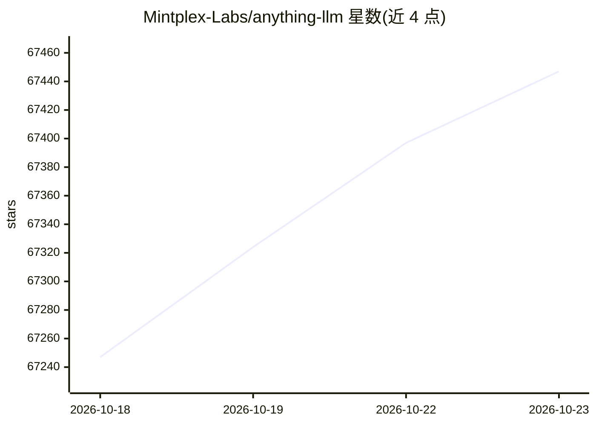

# Mintplex-Labs/anything-llm

⭐ 67,447 · JavaScript · MIT · 推送 2026-10-22 · [GitHub](https://github.com/Mintplex-Labs/anything-llm) · [官网](https://anythingllm.com) · 组织维护

**本地优先的一体化 AI 应用：私聊文档、运行 AI Agent**

一体化 AI 应用：接入本地或云端 LLM，导入 PDF/DOCX 等文档后即可对话，内置 agent、多用户权限、向量数据库与文档处理管道。支持 Docker 多用户部署与可嵌入聊天组件，桌面版覆盖 Mac/Windows/Linux，Android 客户端开源。自带本地 LLM 引擎（Lemonade/llama.cpp，支持 CUDA/Vulkan），遥测可关闭。

## 筛选速览

| 维度 | 判定 | 备注 |
|---|---|---|
| AI 角色 | `ai-native` | 本体是模型或模型工具 |
| 许可风险 | `permissive` | MIT |
| 部署形态 | `None` |  |
| 模型依赖 | local-ok | 支持本地模型 |
| 硬件要求 | — | 无带数字的原话,不猜 |
| 安装摩擦 | `medium` | 含编译或系统依赖之一 |
| 成熟度 | — | 结构信号不足 |

## 动量与使用信号

- 维护:`active` — 距上次 push 1.3 天,年发版 17,264 位贡献者
- 涨星:近 1 天 **+66**(自 20261016 起算)
- 平台:WINDOWS / LINUX / ANDROID · 协议:OPENAI-API / MCP / OLLAMA

## 能力要点

- 内置本地 LLM 引擎，CPU/GPU（CUDA/Vulkan）运行本地模型
- 支持 40+ LLM 提供商与 9 种向量数据库
- 无代码 AI Agent 构建器与 MCP 兼容
- 多用户实例与权限管理（Docker 版）

## 适用场景

- 搭一个私有化、多用户的文档问答系统
- 用本地模型和内置 Agent 自动化工作流
- 通过可嵌入聊天组件在网站上接入 AI 问答

## 场景标签

`文档问答` `工作流自动化` `GUI 自动化` · 领域:效率与自动化

## 证据(README 行号)

> L37: AnythingLLM is the all-in-one AI application that lets you build a private, fully-featured ChatGPT—without compromi
> L43: - Built-in local LLM engine - Run local models on your CPU or GPU (NVIDIA via CUDA, AMD and Intel via Vulkan) with 
> L52: - 👤 Multi-user instance support and permissioning _Docker version only_

## 星数曲线

2026-10-18 67,247 → 2026-10-23 67,447（+200）

---
*卡片 v1 · prompt 1.4 · 生成 2026-10-18 · 置信度 high · 依据 README sha `2234cbe0b505` · [字段定义](../../DATASET.md)*
