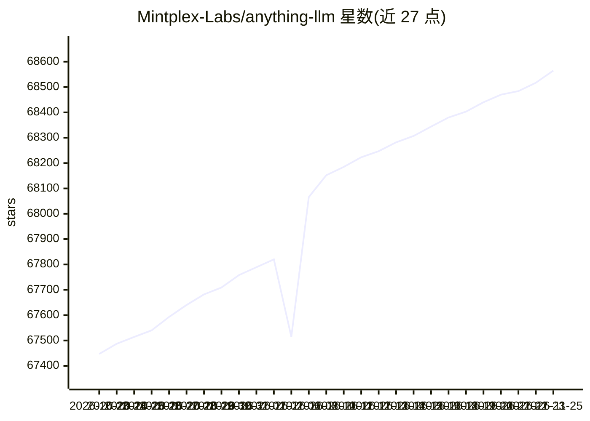

# Mintplex-Labs/anything-llm

⭐ 68,565 · JavaScript · MIT · 推送 2026-11-23 · [GitHub](https://github.com/Mintplex-Labs/anything-llm) · [官网](https://anythingllm.com) · 组织维护 · 中文 README

**本地优先的一体化 AI 应用：文档问答、AI Agent 与多用户管理**

Monorepo 形式的自托管 AI 应用，由 frontend、server、collector、embed、browser-extension 等模块组成。用户可接入本地或云端 LLM，摄入 PDF/TXT/DOCX 等文档进行带来源引用的对话，并使用内置 Agent、无代码 Agent 构建、定时任务与 MCP 兼容能力。支持多用户与权限控制（Docker 版）、多种向量数据库（默认 LanceDB）、多模态与语音转写/合成。提供桌面安装包（Mac/Windows/Linux）、Android 移动端及 Docker、AWS、GCP 等多种部署方式。匿名遥测可通过环境变量关闭。

## 筛选速览

| 维度 | 判定 | 备注 |
|---|---|---|
| AI 角色 | `ai-native` | 本体是模型或模型工具 |
| 许可风险 | `permissive` | MIT |
| 部署形态 | `None` |  |
| 模型依赖 | local-ok | 支持本地模型 |
| 硬件要求 | — | 无带数字的原话,不猜 |
| 安装摩擦 | `medium` | 含编译或系统依赖之一 |
| 成熟度 | — | 结构信号不足 |

## 动量与使用信号

- 维护:`active` — 距上次 push 1.3 天,年发版 17,264 位贡献者
- 涨星:近 1 天 **+66**(自 20261016 起算)
- 平台:WINDOWS / LINUX / ANDROID · 协议:OPENAI-API / MCP / OLLAMA

## 能力要点

- 内置本地 LLM 引擎，经 Lemonade 与 llama.cpp 在 CPU/GPU 上运行本地模型
- 支持大量 LLM、嵌入、转写、TTS 提供方与 9 种向量数据库
- 无代码 AI Agent 构建、定时任务与 MCP 兼容
- Docker 版提供多用户权限与可嵌入网站聊天组件

## 适用场景

- 在本地用自有文档搭建私有知识问答实例
- 为团队部署多用户 LLM 服务并控制权限
- 用 AI Agent 自动化浏览网页等重复工作流
- 在网站上嵌入客服/问答聊天窗口

## 场景标签

`文档问答` `RAG` `聊天机器人` · 领域:对话与助手

## 证据(README 行号)

> L40: AnythingLLM is the all-in-one AI application that lets you build a private, fully-featured ChatGPT—without compromi
> L46: - Built-in local LLM engine - Run local models on your CPU or GPU (NVIDIA via CUDA, AMD and Intel via Vulkan) with 
> L55: - 👤 Multi-user instance support and permissioning _Docker version only_

## 星数曲线

2026-10-23 67,447 → 2026-11-25 68,565（+1,118）

---
*卡片 v1 · prompt 1.4 · 生成 2026-11-22 · 置信度 high · 依据 README sha `550d8f9ac62c` · [字段定义](../../DATASET.md)*
