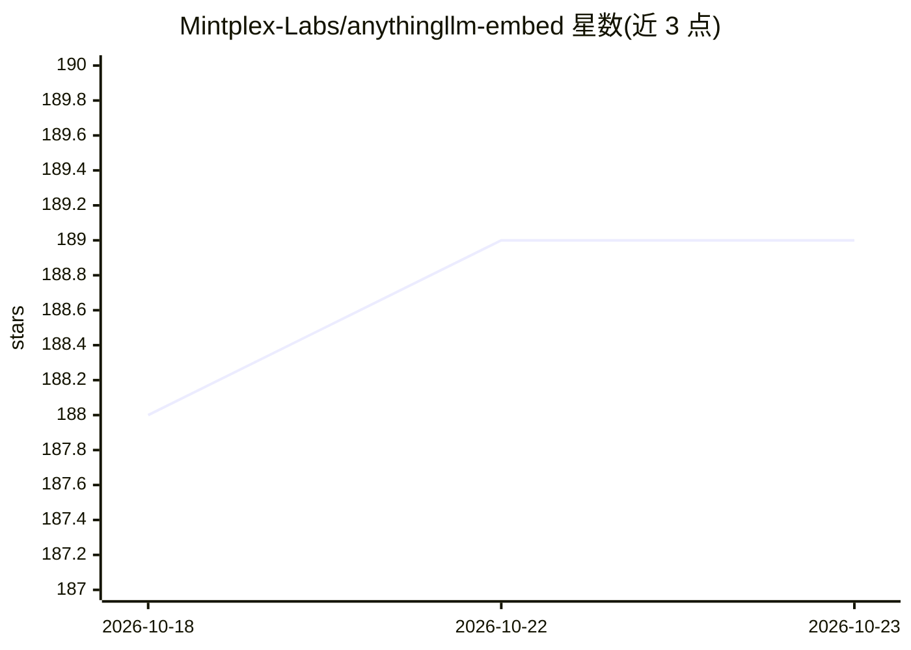

# Mintplex-Labs/anythingllm-embed

⭐ 189 · JavaScript · MIT · 推送 2026-09-21 · [GitHub](https://github.com/Mintplex-Labs/anythingllm-embed) · [官网](https://anythingllm.com) · 组织维护

**AnythingLLM 的网站嵌入式聊天挂件（子模块）**

AnythingLLM 主应用的子模块，提供将工作区及其知识库以聊天气泡形式嵌入任意网站的挂件源码，通过 <script> 标签嵌入，支持自定义系统提示词、模型与温度覆盖、界面语言、气泡样式、位置尺寸、思考过程展示等大量 data-* 属性。官方提醒：核心团队已在主仓库发布预构建版本，仅建议需要自定义构建挂件的开发者使用本仓库；使用方需自行配置以防止模型滥用。iframe 嵌入方式标注为开发中。

## 筛选速览

| 维度 | 判定 | 备注 |
|---|---|---|
| AI 角色 | `ai-ecosystem` | LLM/agent 周边工具 |
| 许可风险 | `permissive` | MIT |
| 部署形态 | `None` |  |
| 模型依赖 | — | README 未给出锁定关系 |
| 硬件要求 | — | 无带数字的原话,不猜 |
| 安装摩擦 | `low` | 无编译、无系统依赖或容器化 |
| 成熟度 | `idea` | |

## 能力要点

- 以 <script> 标签将工作区知识库暴露为网站聊天气泡
- 支持 LLM 覆盖（system prompt / 模型 / temperature）与界面本地化
- 30 余个 data-* 属性自定义样式、位置、问候语、赞助区等
- 开发模式 yarn dev 提供示例页面并支持热重建

## 适用场景

- 在自己的网站上嵌入 AnythingLLM 工作区的客服式聊天窗口
- 定制构建带自有品牌图与配色的聊天挂件
- 限定会话与消息数量以控制公开挂件的用量

## 场景标签

`聊天机器人` `RAG` · 领域:对话与助手

## 证据(README 行号)

> L3: **This is a submodule of AnythingLLM - the all-in-one AI Application**
> L14: The AnythingLLM Embedded chat widget allows you to expose a workspace and its embedded knowledge base as a chat bub
> L12: This folder of AnythingLLM contains the source code for how the embedded version of AnythingLLM works to provide a 

## 星数曲线

2026-10-18 188 → 2026-10-23 189（+1）

---
*卡片 v1 · prompt 1.4 · 生成 2026-10-22 · 置信度 high · 依据 README sha `5e64b5ea5dd8` · [字段定义](../../DATASET.md)*
