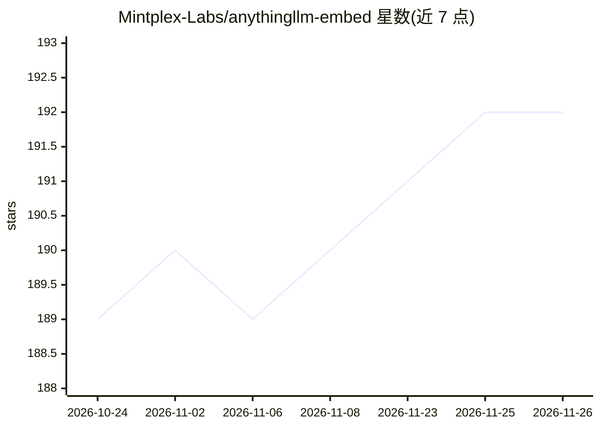

# Mintplex-Labs/anythingllm-embed

⭐ 192 · JavaScript · MIT · 推送 2026-11-24 · [GitHub](https://github.com/Mintplex-Labs/anythingllm-embed) · [官网](https://anythingllm.com) · 组织维护

**为 AnythingLLM 工作区生成可嵌入网站的聊天挂件**

AnythingLLM 主应用的子模块，提供嵌入式聊天挂件的源码：通过 `<script>` 标签将一个工作区及其嵌入知识库以聊天气泡形式暴露到任意网站或 HTML 页面。面向站长/开发者，用于对外提供基于工作区知识库的对话入口。关键机制：随机会话 ID 持久化会话、可限制嵌入总聊天数与每会话聊天数、用户不可查看上下文片段；支持自定义系统提示、模型、温度及界面样式/语言/位置等约 20 个 data-* 配置项。iframe 嵌入方式标注为 work in progress。官方建议非定制需求者直接使用主仓库的预构建版本。

## 筛选速览

| 维度 | 判定 | 备注 |
|---|---|---|
| AI 角色 | `ai-ecosystem` | LLM/agent 周边工具 |
| 许可风险 | `permissive` | MIT |
| 部署形态 | `None` |  |
| 模型依赖 | — | README 未给出锁定关系 |
| 硬件要求 | — | 无带数字的原话,不猜 |
| 安装摩擦 | `low` | 无编译、无系统依赖或容器化 |
| 成熟度 | — | 结构信号不足 |

## 能力要点

- 通过 `<script>` 标签将工作区知识库嵌入为网站聊天气泡
- 支持自定义系统提示、聊天模型与温度覆盖
- 约 20 个 data-* 配置项覆盖界面样式、语言、位置与行为
- 随机会话 ID 与聊天数量限制用于控制滥用

## 适用场景

- 把客服知识库以聊天挂件形式嵌入公司官网
- 为自己的 AnythingLLM 工作区搭建面向公众的对话入口
- 基于该源码定制属于自己的嵌入挂件构建版本

## 场景标签

 · 领域:LLM 应用/网站嵌入组件

## 证据(README 行号)

> L3: **This is a submodule of AnythingLLM - the all-in-one AI Application**
> L12: This folder of AnythingLLM contains the source code for how the embedded version of AnythingLLM works to provide a 
> L14: The AnythingLLM Embedded chat widget allows you to expose a workspace and its embedded knowledge base as a chat bub

## 星数曲线

2026-10-24 189 → 2026-11-26 192（+3）

---
*卡片 v1 · prompt 1.4 · 生成 2026-11-26 · 置信度 high · 依据 README sha `5a462f2422c1` · [字段定义](../../DATASET.md)*
