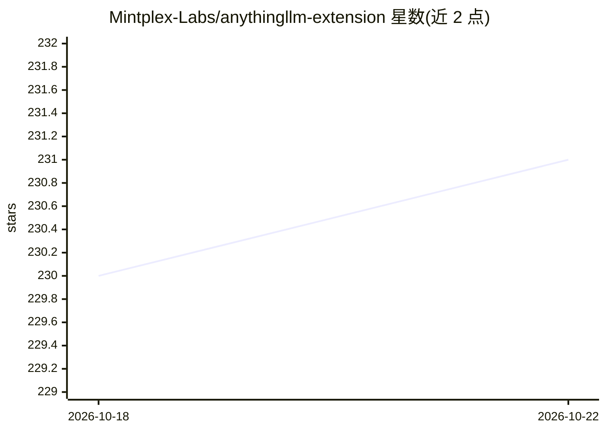

# Mintplex-Labs/anythingllm-extension

⭐ 231 · JavaScript · MIT · 推送 2026-10-22 · [GitHub](https://github.com/Mintplex-Labs/anythingllm-extension) · [官网](https://anythingllm.com) · 组织维护

**将网页内容送入 AnythingLLM 的 Chrome 扩展**

Mintplex Labs 维护的 Chrome 浏览器扩展，用于连接本地或远程的 AnythingLLM 实例（Docker 或桌面版）。通过连接字符串或自动注册完成接入后，用户可在任意网页上右键保存选中文字或整页内容到 AnythingLLM，并嵌入指定工作区，同时自动同步实例 logo。提供 Chrome 商店安装与开发者模式加载 dist 目录两种安装方式，开发使用 yarn。

## 筛选速览

| 维度 | 判定 | 备注 |
|---|---|---|
| AI 角色 | `ai-ecosystem` | LLM/agent 周边工具 |
| 许可风险 | `permissive` | MIT |
| 部署形态 | `None` |  |
| 模型依赖 | — | README 未给出锁定关系 |
| 硬件要求 | — | 无带数字的原话,不猜 |
| 安装摩擦 | `low` | 无编译、无系统依赖或容器化 |
| 成熟度 | — | 结构信号不足 |

## 能力要点

- 通过连接字符串或自动注册接入 AnythingLLM 实例
- 右键保存选中文字或整页到 AnythingLLM
- 内容可嵌入指定工作区
- 自动同步实例 logo

## 适用场景

- 浏览网页时把资料存入 AnythingLLM 知识库
- 把整页内容发送到指定工作区处理
- 配合自建 AnythingLLM 实例收集素材

## 场景标签

`网页抓取` · 领域:效率与自动化

## 证据(README 行号)

> L1: # AnythingLLM Chrome Extension
> L16: - 🔗 Connect to your AnythingLLM instance with a simple connection string or automatic browser extension registratio

## 星数曲线

2026-10-18 230 → 2026-10-22 231（+1）

---
*卡片 v1 · prompt 1.4 · 生成 2026-10-22 · 置信度 high · 依据 README sha `e1c7668174b0` · [字段定义](../../DATASET.md)*
