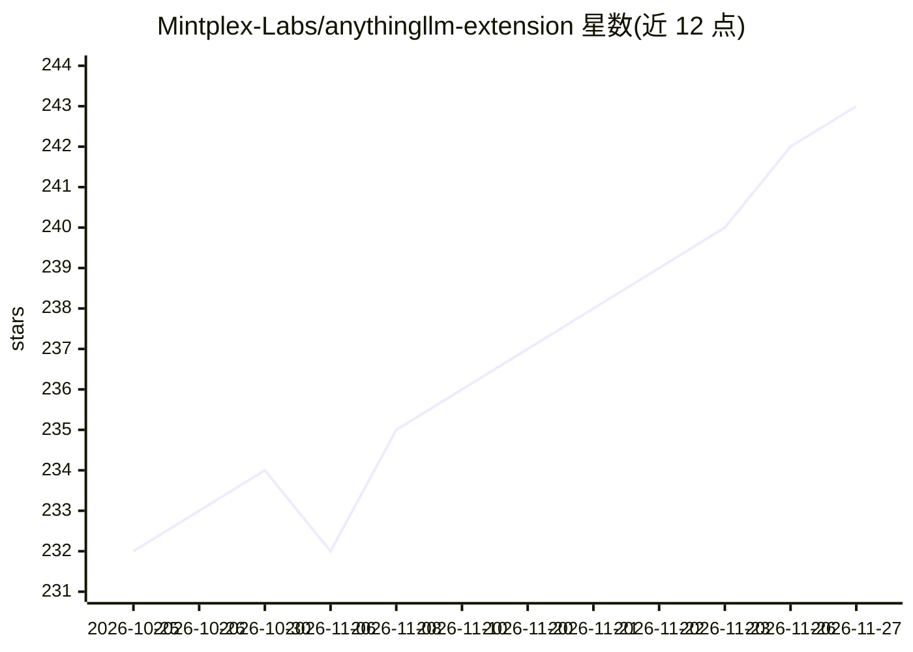

# Mintplex-Labs/anythingllm-extension

⭐ 243 · JavaScript · MIT · 推送 2026-11-17 · [GitHub](https://github.com/Mintplex-Labs/anythingllm-extension) · [官网](https://anythingllm.com) · 组织维护

**AnythingLLM 的浏览器伴侣扩展：在任意网页侧边栏对话**

面向 AnythingLLM（Desktop/Docker/Cloud，1.20.0+ 实例）的浏览器伴侣扩展：把当前标签页一键作为上下文对话，支持 @ 引用其他打开的标签页、右键对选中文本执行 Ask/Summarize/Explain/Rewrite 等操作、拖拽或粘贴附件、麦克风语音输入、面板内 Agent 工具调用审批，聊天线程同步回 AnythingLLM 工作区。可从 Chrome Web Store 安装，或用 Node.js 18+ 与 Yarn 自行构建后加载到 Chrome。

## 筛选速览

| 维度 | 判定 | 备注 |
|---|---|---|
| AI 角色 | `ai-ecosystem` | LLM/agent 周边工具 |
| 许可风险 | `permissive` | MIT |
| 部署形态 | `None` |  |
| 模型依赖 | — | README 未给出锁定关系 |
| 硬件要求 | — | 无带数字的原话,不猜 |
| 安装摩擦 | `low` | 无编译、无系统依赖或容器化 |
| 成熟度 | — | 结构信号不足 |

## 能力要点

- 当前标签页一键作为上下文，@ 可引入其他打开的标签页
- 右键选中文字执行 Ask/Summarize/Explain/Rewrite/纠错
- 聊天线程自动同步保存到 AnythingLLM 工作区
- 数据只发送到用户连接的 AnythingLLM 实例

## 适用场景

- 边浏览网页边向自己的 AnythingLLM 工作区提问
- 选中网页文字后直接调用 AI 总结或改写
- 把网页或整页内容存入 AnythingLLM 工作区

## 场景标签

`聊天机器人` `AI 助手` · 领域:对话与助手

## 证据(README 行号)

> L5:  Chat with any page using AnythingLLM from your browser.
> L14: > The companion needs a running AnythingLLM instance, version **1.20.0 or newer**. Desktop, Docker, and Cloud insta
> L71: - AnythingLLM: the all-in-one AI app this extension connects to

## 星数曲线

2026-10-25 232 → 2026-11-27 243（+11）

---
*卡片 v1 · prompt 1.4 · 生成 2026-11-26 · 置信度 high · 依据 README sha `ed517d500804` · [字段定义](../../DATASET.md)*
