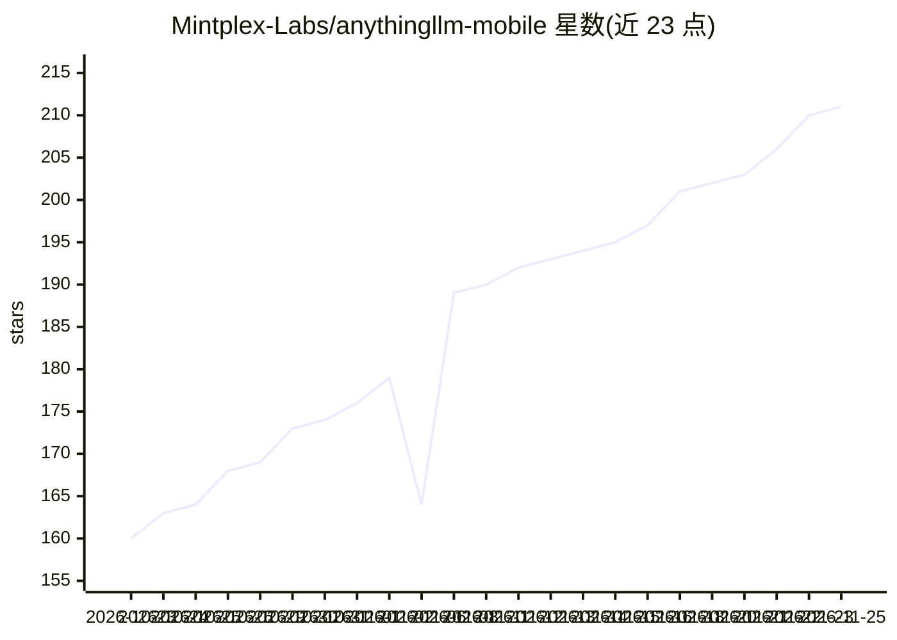

# Mintplex-Labs/anythingllm-mobile

⭐ 211 · TypeScript · GPL-3.0 · 推送 2026-11-24 · [GitHub](https://github.com/Mintplex-Labs/anythingllm-mobile) · [官网](https://anythingllm.com/mobile) · 组织维护

**本地优先的手机 AI 助手：端侧模型+文档+定时任务**

AnythingLLM 的移动端（Android），采用混合架构：手机作为 agent 宿主，模型可选端侧 GGUF 推理（llama.rn）、局域网内 LM Studio/Ollama/llama.cpp 等，或云服务商。功能含屏幕级默认助手、任意应用划词处理、后台定时任务、端侧 RAG（PDF/Word/Excel，嵌入与重排均在本地）、文档生成、记忆系统、Hugging Face 模型浏览与下载（带机型适配标记）。当前仅支持 Android，iOS 未支持；贡献需签署 CLA。

## 筛选速览

| 维度 | 判定 | 备注 |
|---|---|---|
| AI 角色 | `ai-native` | 本体是模型或模型工具 |
| 许可风险 | `viral` | GPL-3.0 |
| 部署形态 | `None` |  |
| 模型依赖 | local-ok | 支持本地模型 |
| 硬件要求 | — | 无带数字的原话,不猜 |
| 安装摩擦 | `low` | 无编译、无系统依赖或容器化 |
| 成熟度 | — | 结构信号不足 |

## 能力要点

- 端侧 GGUF 推理（llama.rn）与多模态图片对话，离线可用
- 端侧 RAG：嵌入、向量库与重排均在手机本地完成
- 默认助手/划词工具栏/分享入口等系统级集成
- 支持 20+ 提供商及任意 OpenAI 兼容 API，含自动模型发现

## 适用场景

- 在无网络环境下离线使用 AI 对话与文档问答
- 把手机设为默认助手，随时对屏幕内容提问
- 设置定时后台任务如每日新闻摘要
- 本地读取和管理 Hugging Face 上的 GGUF 模型

## 场景标签

`AI 助手` `文档问答` `RAG` · 领域:对话与助手

## 证据(README 行号)

> L28: Mobile devices, even the most cutting edge, are quite limited in models they can run before they overheat or run ou
> L102: ### Supported Providers

## 星数曲线

2026-10-23 160 → 2026-11-25 211（+51）

---
*卡片 v1 · prompt 1.4 · 生成 2026-11-25 · 置信度 high · 依据 README sha `e7ded4a5d519` · [字段定义](../../DATASET.md)*
