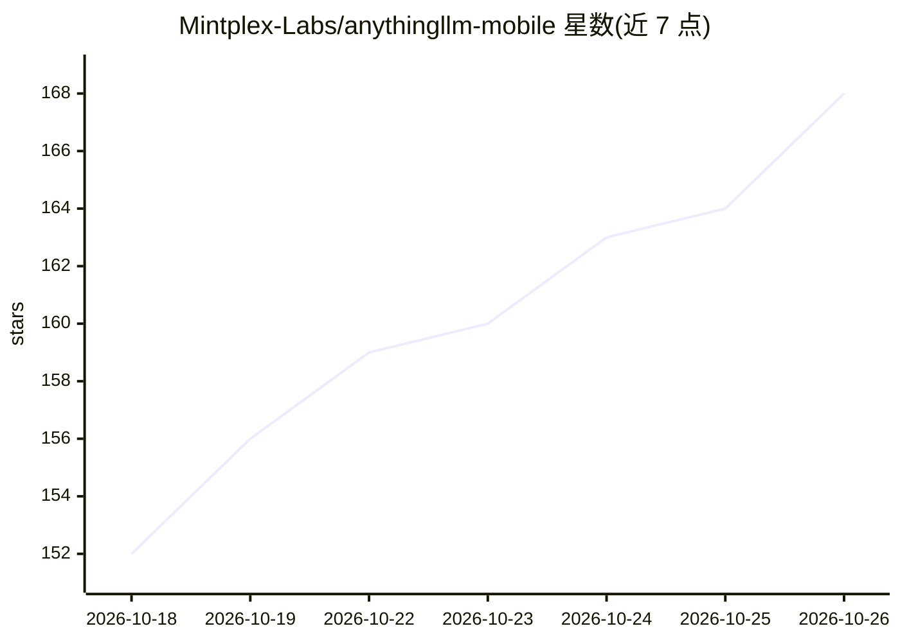

# Mintplex-Labs/anythingllm-mobile

⭐ 168 · TypeScript · GPL-3.0 · 推送 2026-10-05 · [GitHub](https://github.com/Mintplex-Labs/anythingllm-mobile) · [官网](https://anythingllm.com/mobile) · 组织维护

**手机端本地优先的 AI Agent 应用：隐私优先的随身助手**

Mintplex Labs 出品的 Android AI Agent 应用，采用混合架构：手机作为 agent harness，可在设备上用 llama.rn 运行 GGUF 小模型实现离线推理，也可连接 Ollama、LM Studio、AnythingLLM 实例或云端服务商（Anthropic/OpenAI/OpenRouter 等）。功能包括设为系统默认助手、任意应用内文本处理、定时后台任务、设备端 RAG 文档问答、Agent 式网页搜索、文档生成与记忆系统；数据默认留在手机上。iOS 尚未支持，通过 Google Play 分发。

## 筛选速览

| 维度 | 判定 | 备注 |
|---|---|---|
| AI 角色 | `ai-native` | 本体是模型或模型工具 |
| 许可风险 | `viral` | GPL-3.0 |
| 部署形态 | `None` |  |
| 模型依赖 | local-ok | 支持本地模型 |
| 硬件要求 | — | 无带数字的原话,不猜 |
| 安装摩擦 | `low` | 无编译、无系统依赖或容器化 |
| 成熟度 | — | 结构信号不足 |

## 能力要点

- 设备端 GGUF 推理（llama.rn），完全离线可用
- 设备端 RAG：嵌入、向量库与重排序均在本地运行
- 可设为系统默认助手，任意应用内唤起语音/文字问答
- 支持 Ollama、LM Studio、AnythingLLM 实例及约 20 家云端服务商接入

## 适用场景

- 在手机上离线与本地模型对话并问答自己的文档
- 把手机助手换成自带模型的可定制 AI 助手
- 设置定时任务（如每日新闻摘要）在后台运行
- 在任意应用中选中文本进行润色、摘要或解释

## 场景标签

`AI 助手` `文档问答` · 领域:对话与助手

## 证据(README 行号)

> L25: Mobile devices, even the most cutting edge, are quite limited in models they can run before they overheat or run ou
> L73: - **On-device LLM inference** - Run GGUF models locally with llama.rn (llama.cpp for React Native). Works with no s
> L90: - 🎙️ **Voice input** - Tap the mic and talk. Speech-to-text uses your phone's native recognition and keeps up with 

## 星数曲线

2026-10-18 152 → 2026-10-26 168（+16）

---
*卡片 v1 · prompt 1.4 · 生成 2026-10-22 · 置信度 high · 依据 README sha `2877fd88432d` · [字段定义](../../DATASET.md)*
