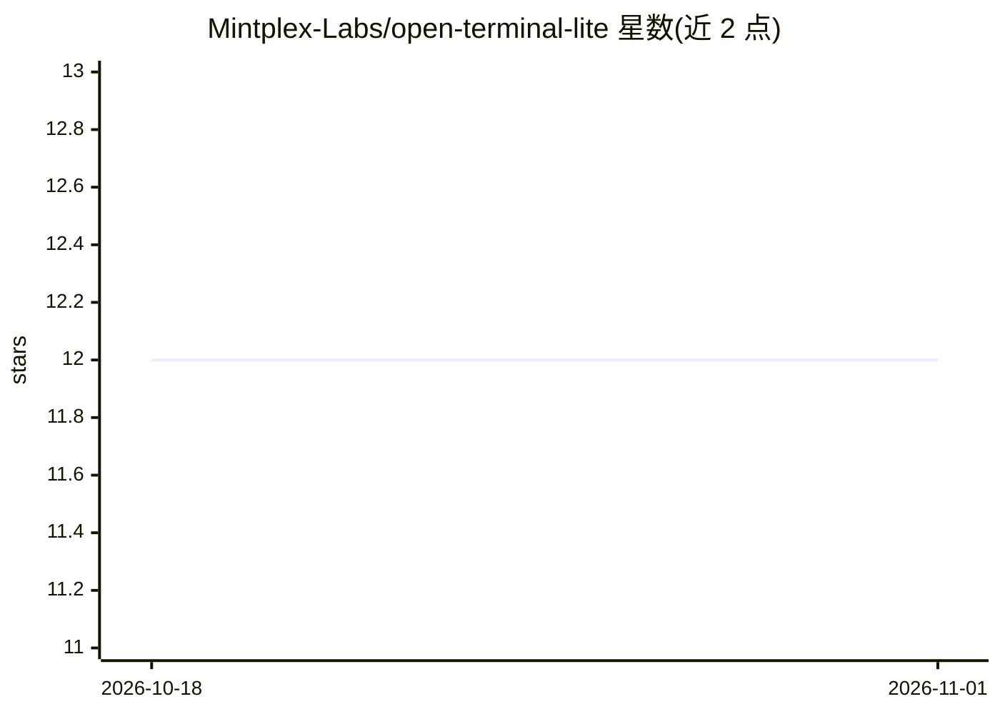

# Mintplex-Labs/open-terminal-lite

⭐ 12 · JavaScript · MIT · 推送 2026-03-03 · [GitHub](https://github.com/Mintplex-Labs/open-terminal-lite) · 组织维护

**给 AI agent 提供自托管命令执行环境的轻量终端服务**

open-webui/open-terminal 的 Node.js 重写版，以约 400MB 的 Alpine Docker 镜像自托管运行，通过 API 与内置 MCP server 让 AI agent（如 AnythingLLM 等 MCP 兼容应用）在受控环境中运行命令、管理文件与执行代码。支持基于卷的多用户沙箱隔离、按需通过环境变量安装工具包（编辑器/语言/数据科学等）、Docker 资源限制与 Docker secrets。原版的 API 与功能保持一致，工具安装完成前命令执行返回 503。

## 筛选速览

| 维度 | 判定 | 备注 |
|---|---|---|
| AI 角色 | `ai-ecosystem` | LLM/agent 周边工具 |
| 许可风险 | `permissive` | MIT |
| 部署形态 | `self-host` | docker 或自建部署 |
| 模型依赖 | — | README 未给出锁定关系 |
| 硬件要求 | — | 无带数字的原话,不猜 |
| 安装摩擦 | `low` | 无编译、无系统依赖或容器化 |
| 成熟度 | — | 结构信号不足 |

## 能力要点

- 约 400MB Alpine 基础镜像，较原版约 4GB 显著缩减
- 内置 MCP server，可接入 MCP 兼容应用
- 环境变量驱动的按需工具安装（语言/数据/云 CLI 等 13 类）
- 基于卷的多用户沙箱隔离与 Docker secrets 支持

## 适用场景

- 为 AnythingLLM 等 AI 工具提供可托管的多用户终端执行环境
- 管理员按需配置工具集并限制容器资源用于不受信任务
- 作为 MCP 工具接入 agent 框架执行命令与文件操作

## 场景标签

 · 领域:AI agent 基础设施

## 证据(README 行号)

> L3: A lightweight, self-hosted terminal that gives AI agents a dedicated environment to run commands, manage files, and 
> L5: > **This is a fork of open-webui/open-terminal**, rebuilt from the ground up in Node.js for lightweight, multi-user 
> L144: Open-Terminal-Lite includes a built-in MCP server for use with MCP-compatible applications.

## 星数曲线

2026-10-18 12 → 2026-11-01 12（+0）

---
*卡片 v1 · prompt 1.4 · 生成 2026-11-01 · 置信度 high · 依据 README sha `aa2d52b6c6f2` · [字段定义](../../DATASET.md)*
