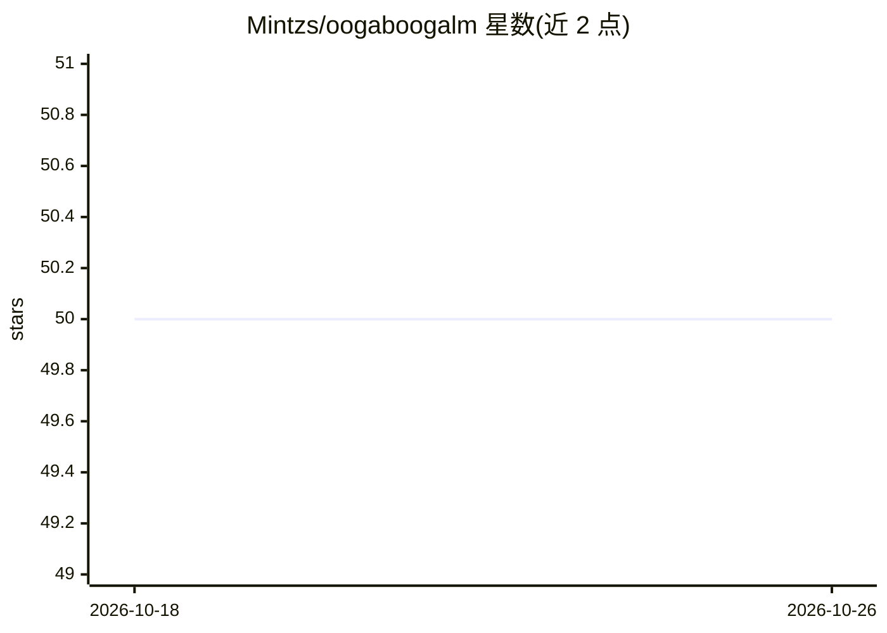

# Mintzs/oogaboogalm

⭐ 50 · Apache-2.0 · 推送 2026-04-15 · [GitHub](https://github.com/Mintzs/oogaboogalm) · 个人维护

**微调模型：默认输出极简回答以降低 token 消耗**

OogaBoogaLM 是基于 Qwen2.5-7B-Instruct 与 Qwen3-8B 的 QLoRA 微调模型（GGUF q4_k_m 量化），通过 500 条无系统提示的合成数据训练，使模型默认产出精简回答，无需附加 'Be concise' 类系统提示。提供 HuggingFace 模型下载，可用 Ollama 本地运行，或经 OpenAI SDK / LangChain 调用。附 token 压缩基准与 HumanEval+ 结果；README 自述局限性：小数据集可能不泛化、极简回答可能省略必要上下文、不适合教学类长文场景。

## 筛选速览

| 维度 | 判定 | 备注 |
|---|---|---|
| AI 角色 | `ai-native` | 本体是模型或模型工具 |
| 许可风险 | `permissive` | Apache-2.0 |
| 部署形态 | `library` | 以包/库形式分发 |
| 模型依赖 | local-ok | 支持本地模型 |
| 硬件要求 | — | 无带数字的原话,不猜 |
| 安装摩擦 | `low` | 无编译、无系统依赖或容器化 |
| 成熟度 | — | 结构信号不足 |

## 能力要点

- QLoRA 微调 Qwen2.5-7B 与 Qwen3-8B，简洁性写入权重、无需系统提示
- 基准显示 token 压缩：caveman-qwen 平均 82.8 vs 基座 473.7（5.72x）
- 提供 Ollama 拉取运行及 OpenAI SDK / LangChain 调用示例
- 128K 上下文窗口，GGUF q4_k_m 量化

## 适用场景

- 降低大规模 API 调用的输出 token 成本
- 多步 agent 流水线中减少回答冗长带来的 token 叠加
- 希望不加系统提示就得到简短回答的本地部署

## 场景标签

`微调` · 领域:训练与推理

## 证据(README 行号)

> L17: OogaBoogaLM is a **QLoRA fine-tune of Qwen2.5-7B-Instruct and Qwen3-8B** trained to produce minimized, direct, high
> L29: OogaBoogaLM eliminates this entirely — the compression behavior lives in the weights.

## 星数曲线

2026-10-18 50 → 2026-10-26 50（+0）

---
*卡片 v1 · prompt 1.4 · 生成 2026-10-24 · 置信度 mid · 依据 README sha `5d3a21233313` · [字段定义](../../DATASET.md)*
