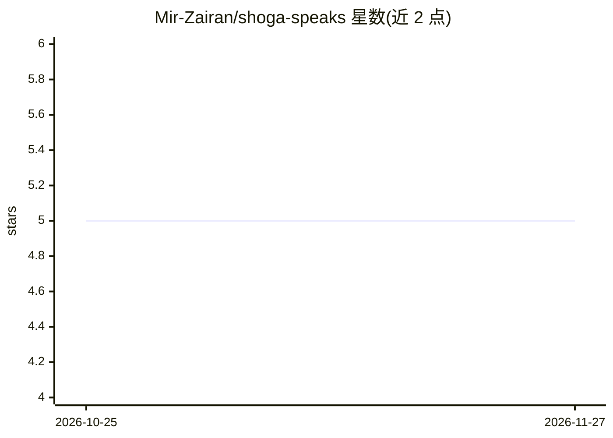

# Mir-Zairan/shoga-speaks

⭐ 5 · JavaScript · MIT · 推送 2026-10-20 · [GitHub](https://github.com/Mir-Zairan/shoga-speaks) · 个人维护

**让 Claude Code 用用户母语和角色身份解释回答的插件**

面向以乌尔都语、印地语、荷兰语等非英语思考的开发者及 QA/PO/PM/支持等角色的 Claude Code 插件。机制：将每条回答翻译为所选语言与文字，按角色调整内容侧重（开发者给修复、QA 给测试步骤、PO 给决策）；对删除类命令给出通俗审批说明，先以一句通俗话解释失败，并对每条回复检查难词、混合文字与长度。设置写入 ~/.claude/shoga-speaks.json，提供 en/tech/story/huh 等快捷指令与可添加语言的 Markdown 扩展方式。

## 筛选速览

| 维度 | 判定 | 备注 |
|---|---|---|
| AI 角色 | `ai-ecosystem` | LLM/agent 周边工具 |
| 许可风险 | `permissive` | MIT |
| 部署形态 | `None` |  |
| 模型依赖 | — | README 未给出锁定关系 |
| 硬件要求 | — | 无带数字的原话,不猜 |
| 安装摩擦 | `low` | 无编译、无系统依赖或容器化 |
| 成熟度 | — | 结构信号不足 |

## 能力要点

- 按语言与文字（罗马乌尔都语、乌尔都文、天城文、荷兰语等）输出回答
- 按 dev/qa/devops/po/pm/support 六种角色调整内容侧重
- 删除类命令的通俗语言审批与失败解释
- 对每条回复检查难词、混合文字与长度

## 适用场景

- QA 或产品经理用自己的语言询问 PR 是否可发布
- 非英语母语者降低阅读 Claude Code 回答的负担
- 在 GitHub 上生成双语 PR 评论

## 场景标签

 · 领域:开发者工具/AI 编程辅助本地化

## 证据(README 行号)

> L3:  A Claude Code plugin that explains everything in your language, your script and for your role.
> L7:  Claude Code plugin
> L11: Claude Code answers in developer English. If you are a QA tester, product owner or project manager, or you think in

## 星数曲线

2026-10-25 5 → 2026-11-27 5（+0）

---
*卡片 v1 · prompt 1.4 · 生成 2026-11-21 · 置信度 high · 依据 README sha `3cdb52f32792` · [字段定义](../../DATASET.md)*
