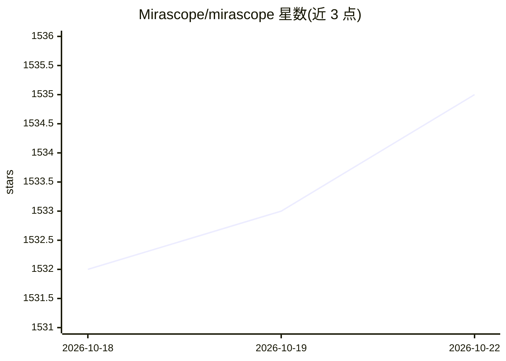

# Mirascope/mirascope

⭐ 1,536 · Python · MIT · 推送 2026-10-22 · [GitHub](https://github.com/Mirascope/mirascope) · [官网](https://mirascope.com) · 组织维护

**统一接口调用各类前沿 LLM 的 Python/TS 库**

自称「LLM Anti-Framework」的库：以装饰器方式用统一接口调用任意前沿 LLM，支持通过 Pydantic 获取结构化输出、构建带工具调用的 Agent，并提及流式、异步与多轮对话等能力（详见文档）。仓库为 monorepo，含 Python 与 TypeScript 两种实现及各自示例，另有营销网站与统一文档；使用语义化版本，MIT 许可证。面向构建 LLM 应用的开发者。

## 筛选速览

| 维度 | 判定 | 备注 |
|---|---|---|
| AI 角色 | `ai-ecosystem` | LLM/agent 周边工具 |
| 许可风险 | `permissive` | MIT |
| 部署形态 | `library` | 以包/库形式分发 |
| 模型依赖 | — | README 未给出锁定关系 |
| 硬件要求 | — | 无带数字的原话,不猜 |
| 安装摩擦 | `low` | 无编译、无系统依赖或容器化 |
| 成熟度 | — | 结构信号不足 |

## 能力要点

- 装饰器方式统一接口调用 LLM
- 基于 Pydantic 的结构化输出
- 带工具调用的 Agent 构建
- 同时提供 Python 与 TypeScript 实现

## 适用场景

- 用同一套代码切换不同 LLM 提供商
- 从 LLM 获取符合 Schema 的结构化数据
- 构建带工具调用的 Agent 应用

## 场景标签

`模型网关` `Agent 框架` · 领域:Agent 开发

## 证据(README 行号)

> L13: Welcome to Mirascope, which allows you to use any frontier LLM with one unified interface.
> L25: ```python

## 星数曲线



2026-10-18 1,532 → 2026-10-22 1,535（+3）


---
*卡片 v1 · prompt 1.4 · 生成 2026-10-21 · 置信度 high · 依据 README sha `2026fb671573` · [字段定义](../../DATASET.md)*
