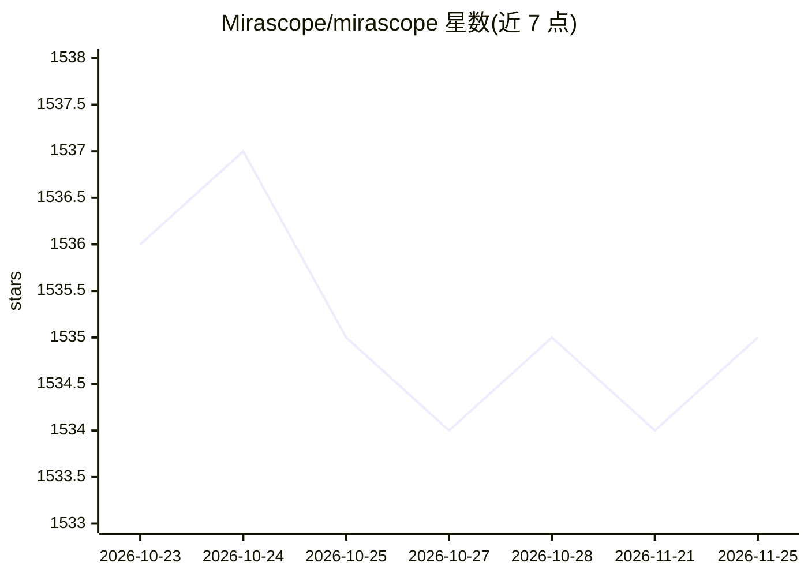

# Mirascope/mirascope

⭐ 1,535 · Python · MIT · 推送 2026-11-23 · [GitHub](https://github.com/Mirascope/mirascope) · [官网](https://mirascope.com) · 组织维护

**统一接口调用任意前沿 LLM 的 Python/TypeScript 库**

Mirascope 是一个 Python 与 TypeScript 双实现的 LLM 接入库，提供统一接口调用不同前沿模型。核心用法包括装饰器方式发起 LLM 调用、基于 Pydantic 模型获取结构化输出、以工具构建 Agent；支持流式输出、异步与多轮对话（见其文档）。项目为 monorepo 结构，含 Python/TypeScript 实现与示例、统一跨语言文档及营销网站，采用语义化版本与 MIT 许可。

## 筛选速览

| 维度 | 判定 | 备注 |
|---|---|---|
| AI 角色 | `ai-ecosystem` | LLM/agent 周边工具 |
| 许可风险 | `permissive` | MIT |
| 部署形态 | `library` | 以包/库形式分发 |
| 模型依赖 | — | README 未给出锁定关系 |
| 硬件要求 | — | 无带数字的原话,不猜 |
| 安装摩擦 | `low` | 无编译、无系统依赖或容器化 |
| 成熟度 | — | 结构信号不足 |

## 能力要点

- 统一接口调用任意前沿 LLM
- 装饰器方式调用 LLM 并获取基于 Pydantic 的结构化输出
- 提供带工具的 Agent 构建方式，支持流式/异步/多轮对话
- Python 与 TypeScript 双语言实现及跨语言统一文档

## 适用场景

- 在 Python 项目中用一套接口切换不同 LLM 提供商
- 用 Pydantic 定义结构从模型获取结构化输出
- 构建带工具调用的 LLM Agent

## 场景标签

`模型网关` `Agent 框架` · 领域:Agent 开发

## 证据(README 行号)

> L13: Welcome to Mirascope, which allows you to use any frontier LLM with one unified interface.
> L40: ### Build an Agent with Tools

## 星数曲线

2026-10-23 1,536 → 2026-11-25 1,535（-1）

---
*卡片 v1 · prompt 1.4 · 生成 2026-11-23 · 置信度 high · 依据 README sha `b2bfc58a181d` · [字段定义](../../DATASET.md)*
