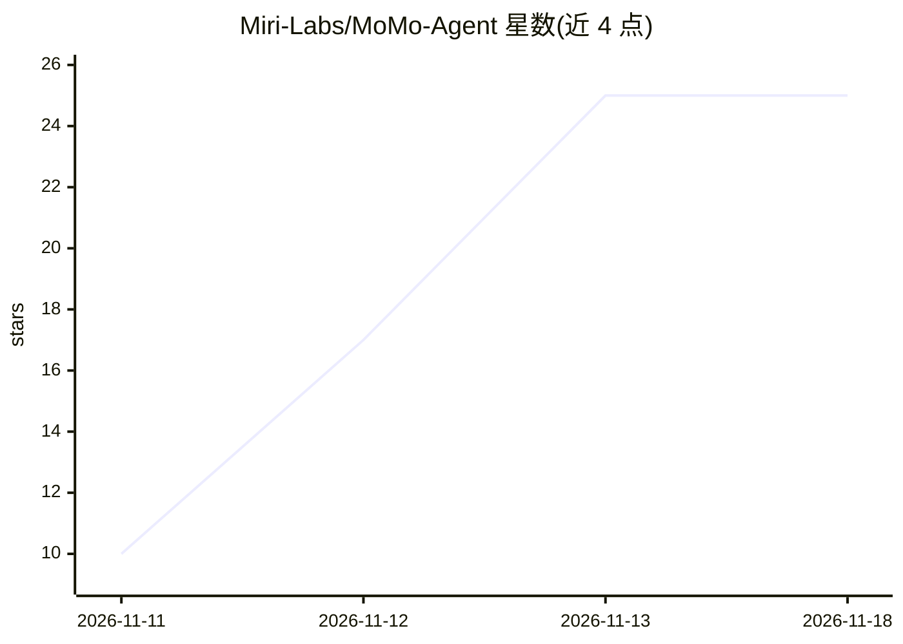

# Miri-Labs/MoMo-Agent

⭐ 25 · Swift · AGPL-3.0 · 推送 2026-11-17 · [GitHub](https://github.com/Miri-Labs/MoMo-Agent) · 组织维护 · 中文 README

**面向 Apple 设备的自托管全天候个人 AI 助理**

开源原生应用，覆盖 Apple Watch、iPhone 与 Mac：通过手表或蓝牙耳机全天录音，在设备端本地完成语音转录与说话人识别（$0 成本），由 Mac 端将对话整理为 Obsidian 式多层 Markdown 记忆库，生成晨间简报、提醒事项与生活日志。模型侧复用用户已有的 Codex、Claude、Antigravity 订阅或自定义 OpenAI 兼容 API 登录，可一键切换。需自行用 Xcode 构建安装，Mac Hub 有预编译包。

## 筛选速览

| 维度 | 判定 | 备注 |
|---|---|---|
| AI 角色 | `ai-native` | 本体是模型或模型工具 |
| 许可风险 | `dual` | AGPL-3.0 |
| 部署形态 | `desktop` | 安装包/桌面程序 |
| 模型依赖 | locked-api |  |
| 硬件要求 | — | 无带数字的原话,不猜 |
| 安装摩擦 | `medium` | 含编译或系统依赖之一 |
| 成熟度 | — | 结构信号不足 |

## 能力要点

- Apple Watch 全天免手持录音，iPhone 本地神经语音转录与声纹识别
- 自组织 Markdown 记忆库，含双向链接与回溯原始音频
- 复用 Codex/Claude/Antigravity 订阅登录，一键切换模型提供方
- 内置 Tailscale 点对点加密组网，外网可达家用 Mac

## 适用场景

- 用 Apple Watch 记录一天对话并自动整理为知识笔记
- 把口头承诺自动转为 Apple 提醒事项与日历事件
- 在自有设备上保留全部语音与记忆数据，不依赖第三方云

## 场景标签

`AI 助手` `知识库管理` `语音识别` · 领域:对话与助手

## 证据(README 行号)

> L19: Capture your day effortlessly from your **Apple Watch** or **Bluetooth earphones**, transcribe speech **100% locall
> L30: - **$0 Extra AI Bills — Reuse the Subscription You Already Own**: An all-day personal agent shouldn't rack up surpr

## 星数曲线

2026-11-11 10 → 2026-11-18 25（+15）

---
*卡片 v1 · prompt 1.4 · 生成 2026-11-18 · 置信度 high · 依据 README sha `f430936e0291` · [字段定义](../../DATASET.md)*
