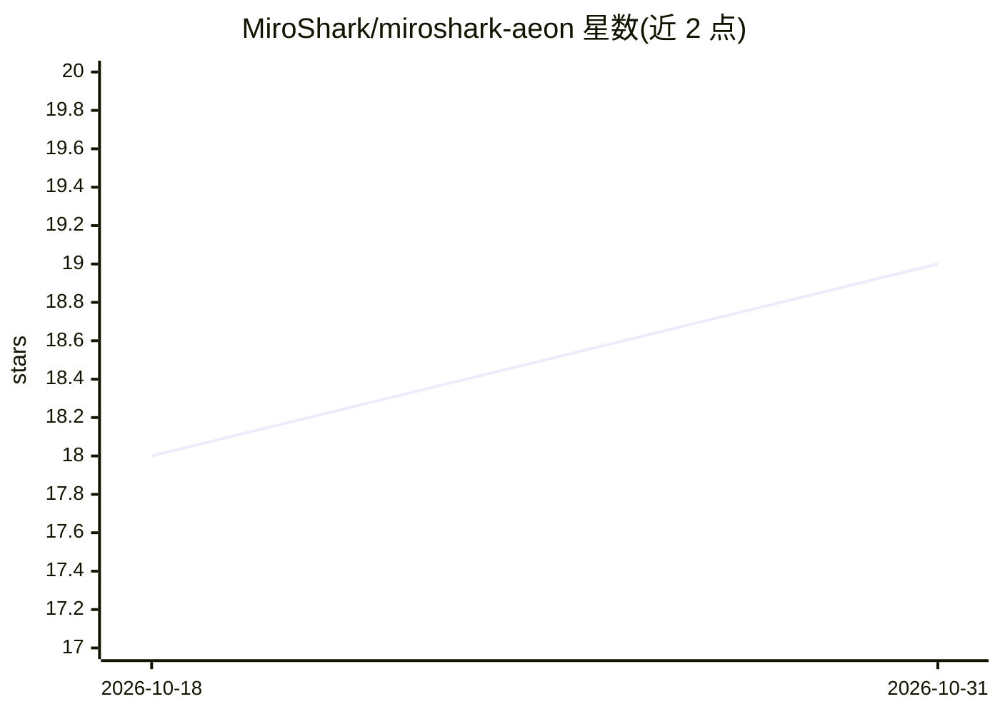

# MiroShark/miroshark-aeon

⭐ 19 · JavaScript · MIT · 推送 2026-10-30 · [GitHub](https://github.com/MiroShark/miroshark-aeon) · [官网](https://t.me/miroshark_aeon) · 个人维护

**MiroShark 的 Aeon 无人值守 agent 实例：在 GitHub Actions 上定时跑技能**

本仓库是 Aeon 框架的一个在用实例：作为 MiroShark 的增长 agent，公开运行 $MIROSHARK 相关事务，在 GitHub Actions cron 上无人值守执行。框架本体在 aeonfun/aeon，以单个 SKILL.md 文件定义技能，同一技能可经 run-harness 契约运行在 Claude、Grok、Codex、Pi、Vibe、Kimi、fx 等 CLI 引擎上；共 6 个技能包 82 项技能，含自我修复（heartbeat/skill-repair/self-improve）与实例分叉成舰队的能力。配置集中在 aeon.yml（cron 调度、模型、通知渠道），自带只读限制与失败即停等护栏。本仓库不自建框架，自建需从 aeonfun/aeon 模板克隆，终端方式需 Node.js 20+ 与 GitHub CLI。

## 筛选速览

| 维度 | 判定 | 备注 |
|---|---|---|
| AI 角色 | `ai-ecosystem` | LLM/agent 周边工具 |
| 许可风险 | `permissive` | MIT |
| 部署形态 | `None` |  |
| 模型依赖 | locked-api |  |
| 硬件要求 | — | 无带数字的原话,不猜 |
| 安装摩擦 | `low` | 无编译、无系统依赖或容器化 |
| 成熟度 | — | 结构信号不足 |

## 能力要点

- 82 项技能、6 个技能包，单个 SKILL.md 即一个技能
- 同一技能经 run-harness 契约运行在 7 种 agent CLI 引擎
- 在 GitHub Actions cron 上无人值守运行：提交 PR、部署应用、漏洞披露
- 自我修复回路（模型评分→skill-repair→self-improve）与实例分叉成舰队

## 适用场景

- 让 agent 按定时计划在我的仓库里提交功能与修 bug
- 托管型无人值守运行深度研究与信息摘要任务
- 从模板自建实例并接入 Claude 订阅 token 或其他模型 key

## 场景标签

`编码 Agent` `多智能体` · 领域:Agent 开发

## 证据(README 行号)

> L1: AEON - the most autonomous agent framework. 82 skills across 9 harnesses (Claude Code, Grok, Codex, Pi, Vibe, Kimi, 
> L13: > **This is a live Aeon instance**: the growth agent for MiroShark, running the MiroShark repo and $MIROSHARK in pu
> L65:  Seven engines, one socket - a SKILL.md flows through run-harness into any of seven agent CLIs: Claude, Grok, Codex

## 星数曲线

2026-10-18 18 → 2026-10-31 19（+1）

---
*卡片 v1 · prompt 1.4 · 生成 2026-10-29 · 置信度 high · 依据 README sha `1263615f6c3b` · [字段定义](../../DATASET.md)*
