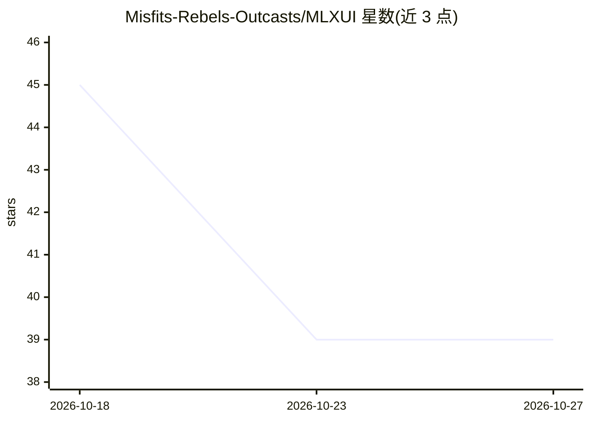

# Misfits-Rebels-Outcasts/MLXUI

⭐ 39 · Swift · MIT · 推送 2026-10-22 · [GitHub](https://github.com/Misfits-Rebels-Outcasts/MLXUI) · [官网](https://connectcode.net/mlxui_local_llm_ai_browser.html) · 组织维护

**Apple Silicon 上的 MLX 本地模型浏览与运行界面**

用 Swift/SwiftUI 编写的原生 macOS 应用，封装 mlx-swift 与 mlx-libraries，让用户在图形界面中浏览、一键下载并运行 Hugging Face mlx-community 的本地模型，按 Chat/Vision/OCR/ASR/TTS/Embeddings 等类型提供专用 Run UI。支持以编号列表编写的 .cat AI 工作流（Pipeline Runner），内置本地服务器在 127.0.0.1:1212 提供 OpenAI/Claude/Codex 三种接口供同机应用调用。仅限 Apple Silicon Mac，通过 Mac App Store 分发，也可从源码构建。

## 筛选速览

| 维度 | 判定 | 备注 |
|---|---|---|
| AI 角色 | `ai-native` | 本体是模型或模型工具 |
| 许可风险 | `permissive` | MIT |
| 部署形态 | `None` |  |
| 模型依赖 | — | README 未给出锁定关系 |
| 硬件要求 | — | 无带数字的原话,不猜 |
| 安装摩擦 | `low` | 无编译、无系统依赖或容器化 |
| 成熟度 | — | 结构信号不足 |

## 能力要点

- ml-community 模型目录一键下载，按模型类型提供专用运行界面
- 可读的编号列表式 .cat AI 工作流（Pipeline Runner）
- 本地服务器暴露 /v1/chat/completions、/v1/messages、/v1/responses 三种接口
- 内存准入检查、prompt cache、仅回环监听的服务器设计

## 适用场景

- 在 Mac 上不碰终端即可下载和运行本地 LLM/语音/视觉模型
- 把多个本地模型串成自动化工作流（转录→总结→保存）
- 让 Xcode、Claude Code、Codex 等同机工具直接使用本地模型

## 场景标签

`工作流自动化` `推理引擎` `AI 助手` · 领域:效率与自动化

## 证据(README 行号)

> L14: MLXUI is the **SwiftUI user interface layer for MLX models** — a native macOS app built on
> L16: run local AI models on Apple Silicon. It ships a curated catalog of MLX-optimized models
> L34: install with a click, and run each model in a purpose-built interface — chat for LLMs,

## 星数曲线

2026-10-18 45 → 2026-10-27 39（-6）

---
*卡片 v1 · prompt 1.4 · 生成 2026-10-25 · 置信度 high · 依据 README sha `53c9ae161453` · [字段定义](../../DATASET.md)*
