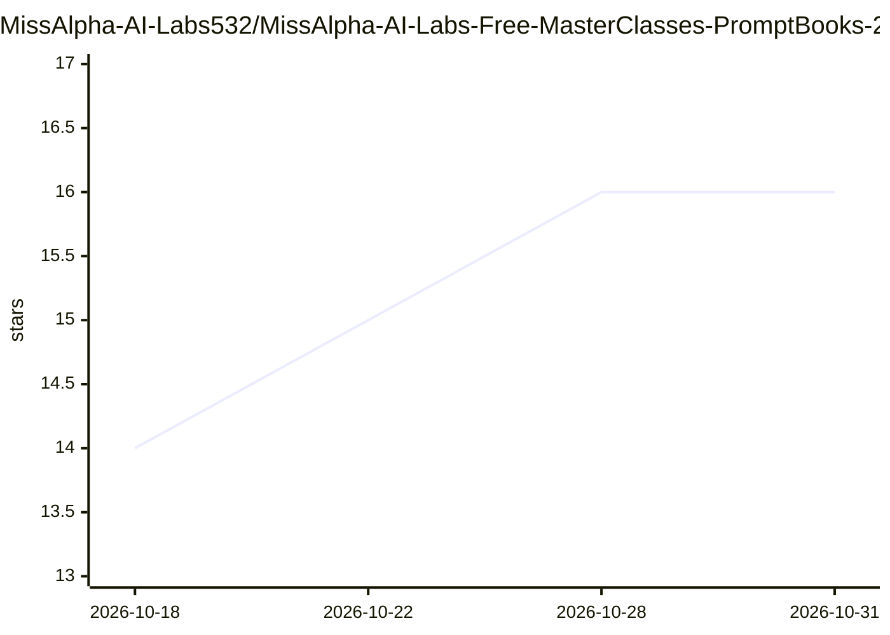

# MissAlpha-AI-Labs532/MissAlpha-AI-Labs-Free-MasterClasses-PromptBooks-28th-June-2026

⭐ 16 · 推送 2026-10-20 · [GitHub](https://github.com/MissAlpha-AI-Labs532/MissAlpha-AI-Labs-Free-MasterClasses-PromptBooks-28th-June-2026) · [官网](www.missalphaailabs.com) · 组织维护

**面向学生与职场人士的免费 AI 课程与提示词资源集合**

MissAlpha™ AI Labs 维护的免费 AI 学习资源仓库：提供 AI Masterclass 的提示词手册、提示词套件、AI 工具指南与实训材料，主题覆盖生成式 AI、Agentic AI、AI Agent、AI 自动化、数据分析、数据科学、GenAI with Python、AI 编码与求职准备等。仓库以主题清单和资源表格形式组织内容，面向学生、开发者、数据分析师、自由职业者与企业人员。README 未给出具体的安装或运行方式，仅描述资源类别与后续更新方向。

## 筛选速览

| 维度 | 判定 | 备注 |
|---|---|---|
| AI 角色 | `ai-knowledge` | 知识聚合/清单类 |
| 许可风险 | `none` | — |
| 部署形态 | `None` |  |
| 模型依赖 | — | README 未给出锁定关系 |
| 硬件要求 | — | 无带数字的原话,不猜 |
| 安装摩擦 | `low` | 无编译、无系统依赖或容器化 |
| 成熟度 | — | 结构信号不足 |

## 能力要点

- 提供 Prompt Books、Prompt Kits、AI 工具指南等可复用学习资源
- 主题覆盖生成式 AI、Agentic AI、AI 自动化、数据分析、AI 编码等方向
- 以资源表格列出 9 类内容（提示词手册/套件、AI/数据/编码/自动化/Agentic/求职资源等）

## 适用场景

- 学习 AI 时获取可复用的提示词模板与工具指南
- 按主题（数据分析、AI 编码、自动化、求职）查找对应学习资源
- 跟随免费 Masterclass 系列获取配套材料

## 场景标签

`教程课程` `提示工程` `精选清单` · 领域:Agent 开发

## 证据(README 行号)

> L7: This repository provides access to selected **Free AI Masterclasses, Prompt Books, Prompt Kits, AI learning resource
> L322: # 📚 What's Inside This Repository?

## 星数曲线

2026-10-18 14 → 2026-10-31 16（+2）

---
*卡片 v1 · prompt 1.4 · 生成 2026-10-30 · 置信度 mid · 依据 README sha `4401f20dcaaa` · [字段定义](../../DATASET.md)*
