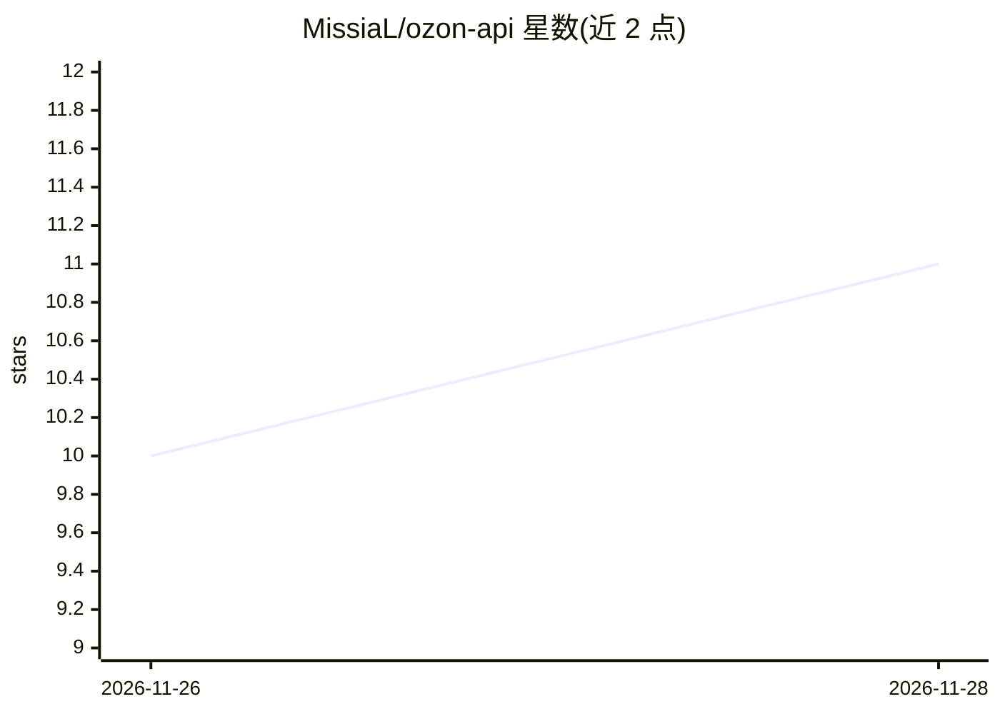

# MissiaL/ozon-api

⭐ 11 · Python · 推送 2026-10-18 · [GitHub](https://github.com/MissiaL/ozon-api) · 个人维护

**为 AI 代理提供 Ozon 卖家与广告 API 的完整 OpenAPI 规格及检索 CLI**

以 Agent Skill 形式组织的 API 参考仓库：收录 2026-10-18 从官方 swagger.json 获取的 Ozon Seller API（483 个操作、56 个分区）与 Performance API（48 个操作）完整 OpenAPI 3.0 规格，附带平面索引与 lookup_endpoint.py 脚本（tags/search/show）供代理按分区查询端点。SKILL.md 说明授权与调用模式。面向使用 Claude/代理工具调用 Ozon 电商接口的开发者。规格可用 build_spec.py 从浏览器下载的官方 JSON 本地重建；更新日期需自行标注。

## 筛选速览

| 维度 | 判定 | 备注 |
|---|---|---|
| AI 角色 | `ai-knowledge` | 知识聚合/清单类 |
| 许可风险 | `none` | — |
| 部署形态 | `None` |  |
| 模型依赖 | — | README 未给出锁定关系 |
| 硬件要求 | — | 无带数字的原话,不猜 |
| 安装摩擦 | `low` | 无编译、无系统依赖或容器化 |
| 成熟度 | — | 结构信号不足 |

## 能力要点

- 官方 OpenAPI 规格快照，含 SHA-256 校验与来源 URL（x-source）
- lookup CLI 按 tags/search/show 导航全部 531 个端点
- 规格含俄语标签与 x-ozon-section 分区索引
- 重建与查询脚本仅依赖 Python 标准库，无需联网

## 适用场景

- 让 Claude/Cursor 等代理准确查找与调用 Ozon 卖家 API 端点
- 本地查询 Ozon 广告（Performance）API 的操作与限流说明
- 自行重建并校验最新官方 API 规格

## 场景标签

 · 领域:电商/API 知识参考

## 证据(README 行号)

> L3: Skill-репозиторий: полные официальные OpenAPI 3.0 спеки Ozon Seller API
> L17: - SKILL.md — точка входа для агента: авторизация, паттерны вызова, грабли.
> L24: - scripts/lookup_endpoint.py — `tags` / `search` / `show`

## 星数曲线

2026-11-26 10 → 2026-11-28 11（+1）

---
*卡片 v1 · prompt 1.4 · 生成 2026-11-26 · 置信度 high · 依据 README sha `8fe835c8ec13` · [字段定义](../../DATASET.md)*
