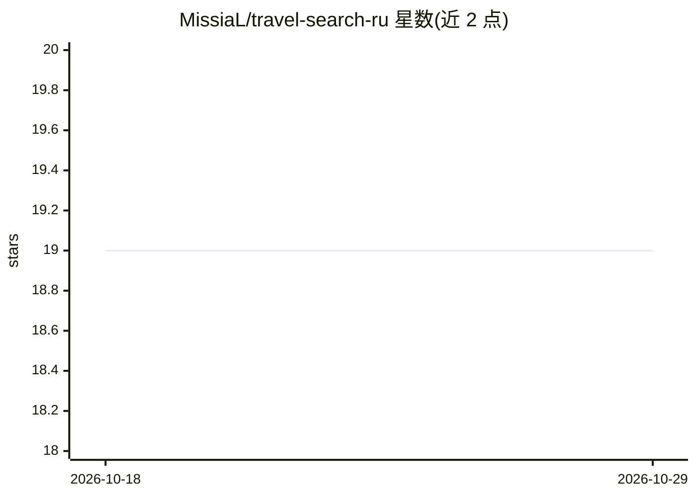

# MissiaL/travel-search-ru

⭐ 19 · Python · MIT · 推送 2026-10-20 · [GitHub](https://github.com/MissiaL/travel-search-ru) · [官网](https://agentskills.io) · 个人维护

**面向 AI agent 的俄语旅游搜索技能：查机票/旅游/酒店/游览**

以 Agent Skill 或远程 MCP 服务器两种方式接入 AI agent 的旅游搜索层：通过 Aviasales、Travelata、Level.Travel、Tutu.ru、Tripster、Sputnik8 等俄语旅游服务检索机票、打包旅游、酒店、火车与游览活动，返回价格、关键参数与预订短链。提供 search-tours、search-flights、search-trains 等 9 个 CLI 命令；仅依赖 Python 3.8+ 标准库。目录与示例面向俄语查询，非俄语请求也可处理；唯一远程端点为 mcp.botclaw.ru，仅传递搜索条件，不执行预订。

## 筛选速览

| 维度 | 判定 | 备注 |
|---|---|---|
| AI 角色 | `ai-ecosystem` | LLM/agent 周边工具 |
| 许可风险 | `permissive` | MIT |
| 部署形态 | `None` |  |
| 模型依赖 | — | README 未给出锁定关系 |
| 硬件要求 | — | 无带数字的原话,不猜 |
| 安装摩擦 | `low` | 无编译、无系统依赖或容器化 |
| 成熟度 | — | 结构信号不足 |

## 能力要点

- Agent Skill 与远程 MCP 服务器两种接入方式
- 覆盖 7 个俄语旅游服务的机票/旅游/酒店/火车/游览搜索
- 9 个 CLI 命令，仅需 Python 3.8+ 标准库
- MCP 端点只读、不传凭据、不做预订与存储

## 适用场景

- 让 Claude Code、Cursor 等 agent 在规划行程时查实时机票和旅游价格
- 通过对话查询俄罗斯出发的打包旅游、火车与游览活动
- 在预订前获取带价格和链接的候选方案

## 场景标签

 · 领域:旅游/AI agent 工具

## 证据(README 行号)

> L22: **Два способа подключения:** Agent Skill или удалённый MCP-сервер.
> L42: Работает с любым AI-агентом, который поддерживает agentskills.io:

## 星数曲线

2026-10-18 19 → 2026-10-29 19（+0）

---
*卡片 v1 · prompt 1.4 · 生成 2026-10-29 · 置信度 high · 依据 README sha `a443389a1dc9` · [字段定义](../../DATASET.md)*
