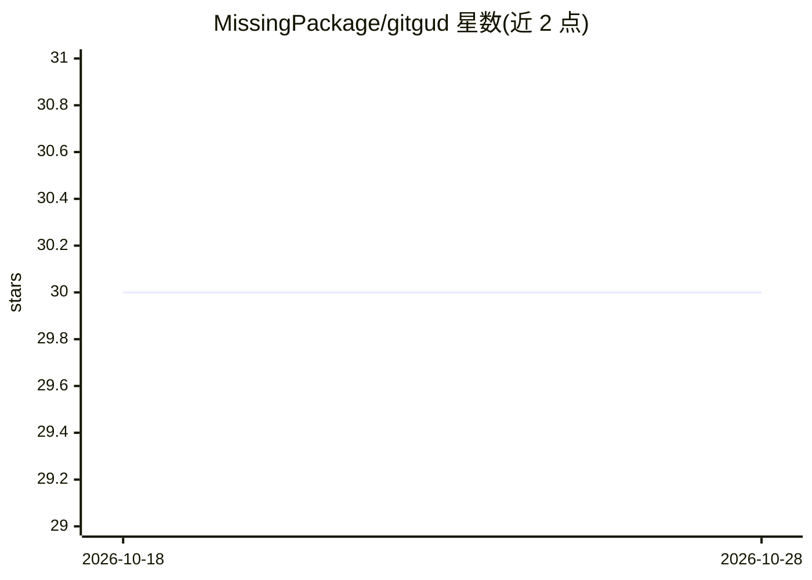

# MissingPackage/gitgud

⭐ 30 · JavaScript · MIT · 推送 2026-01-10 · [GitHub](https://github.com/MissingPackage/gitgud) · [官网](https://github.com/MissingPackage/gitgud) · 个人维护

**Claude Code 插件：定期布置手写编码练习防技能生疏**

面向 Claude Code 与 Cursor IDE 用户的训练插件：每隔 N 次请求（默认 10）自动布置与当前工作上下文相关的手写编码任务，Claude 提供引导但不代写代码。任务按 8 类上下文关键词匹配（安全/API/数据库/测试等），配连续打卡、成就徽章与每日限额跳过机制，数据存于 ~/.gitgud/ 跨插件更新持久化。自述为 v1.0、数小时完成，任务匹配基于简单正则且仅支持英文。

## 筛选速览

| 维度 | 判定 | 备注 |
|---|---|---|
| AI 角色 | `ai-ecosystem` | LLM/agent 周边工具 |
| 许可风险 | `permissive` | MIT |
| 部署形态 | `None` |  |
| 模型依赖 | — | README 未给出锁定关系 |
| 硬件要求 | — | 无带数字的原话,不猜 |
| 安装摩擦 | `low` | 无编译、无系统依赖或容器化 |
| 成熟度 | `idea` | |

## 能力要点

- 每 N 次请求自动布置与上下文相关的编码挑战
- 连续打卡、成就徽章与每日限额跳过的游戏化机制
- 同一仓库同时支持 Claude Code 与 Cursor IDE，进度数据共享（~/.gitgud/）
- 频率/难度/跳过次数可通过 /gg-config 配置

## 适用场景

- 在日常使用 AI 助手编程时保持手写代码练习
- 通过打卡和成就机制维持练习习惯
- 按工作上下文（API、测试、安全等）获得针对性任务

## 场景标签

 · 领域:开发者工具/编程训练

## 证据(README 行号)

> L3: Keep your coding skills sharp while using AI. A Claude Code plugin that periodically assigns manual coding challenge
> L11: - **Periodic Challenges**: Every N requests, you'll get a coding task related to your current work

## 星数曲线

2026-10-18 30 → 2026-10-28 30（+0）

---
*卡片 v1 · prompt 1.4 · 生成 2026-10-26 · 置信度 high · 依据 README sha `1f20e141082f` · [字段定义](../../DATASET.md)*
