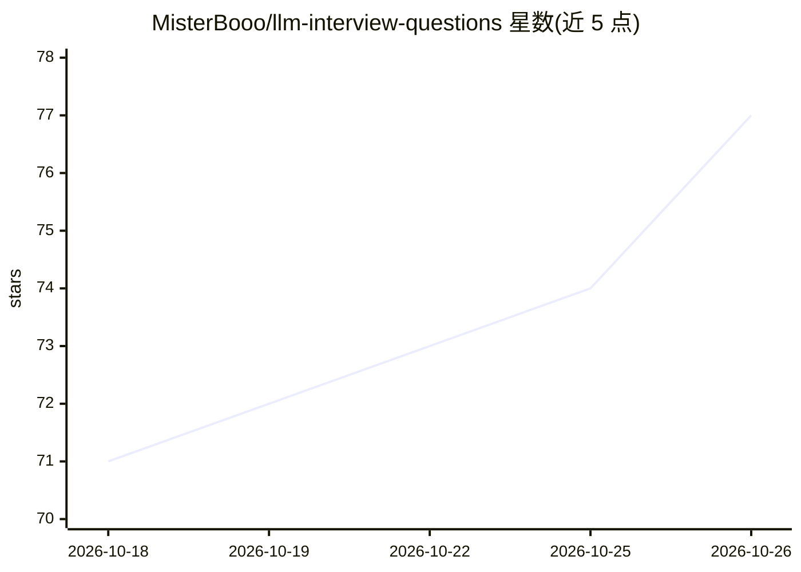

# MisterBooo/llm-interview-questions

⭐ 77 · CC-BY-SA-4.0 · 推送 2026-07-19 · [GitHub](https://github.com/MisterBooo/llm-interview-questions) · [官网](https://www.wushixiongai.com/questions) · 个人维护 · 中文 README

**大模型面试题图解知识库：100 道题配 SVG 概念图**

面向大模型面试准备者与学习者的知识仓库：100 道面试题按 14 个模块组织（模型架构、训练、RLHF 与对齐、微调、推理优化、RAG、Agent、多模态、评估等），每题配 SVG 概念图、直接回答与可回查资料；根目录仅展示 12 道跨模块代表题。内容按来源分级（B 级附可回查链接、C 级为教学整理），保留复核日期与发布文件哈希，提供勘误流程。文字与图解采用 CC BY-SA 4.0 许可。

## 筛选速览

| 维度 | 判定 | 备注 |
|---|---|---|
| AI 角色 | `ai-knowledge` | 知识聚合/清单类 |
| 许可风险 | `viral` | CC-BY-SA-4.0 |
| 部署形态 | `None` |  |
| 模型依赖 | — | README 未给出锁定关系 |
| 硬件要求 | — | 无带数字的原话,不猜 |
| 安装摩擦 | `low` | 无编译、无系统依赖或容器化 |
| 成熟度 | — | 结构信号不足 |

## 能力要点

- 100 道题按 14 个模块组织，每题配 SVG 概念图与直接回答
- 74 题附 202 条可回查资料，按 B/C 来源分级标注
- 内容复核清单、发布文件哈希与勘误提交流程
- CC BY-SA 4.0 许可，允许署名转载与改编

## 适用场景

- 按主题系统准备大模型方向面试
- 用 SVG 图解快速建立 RAG、Agent、推理优化等概念框架
- 通过可回查资料延伸核对原始论文与官方文档

## 场景标签

`教程课程` · 领域:学习与行业

## 证据(README 行号)

> L3: **100 道题、100 张 SVG 概念图，配直接回答和可回查资料**
> L11: 根目录只展示 12 道跨模块代表题，避免首页过长；完整 100 题按 14 个模块拆分，方便按主题阅读。每条内容都保留复核日期、来源等级和官网对应答案，便于核对与勘误。目前 74 题附有 202 条可回查资料，其余条目标明为教学整

## 星数曲线

2026-10-18 71 → 2026-10-26 77（+6）

---
*卡片 v1 · prompt 1.4 · 生成 2026-10-24 · 置信度 high · 依据 README sha `6b03a7380b30` · [字段定义](../../DATASET.md)*
