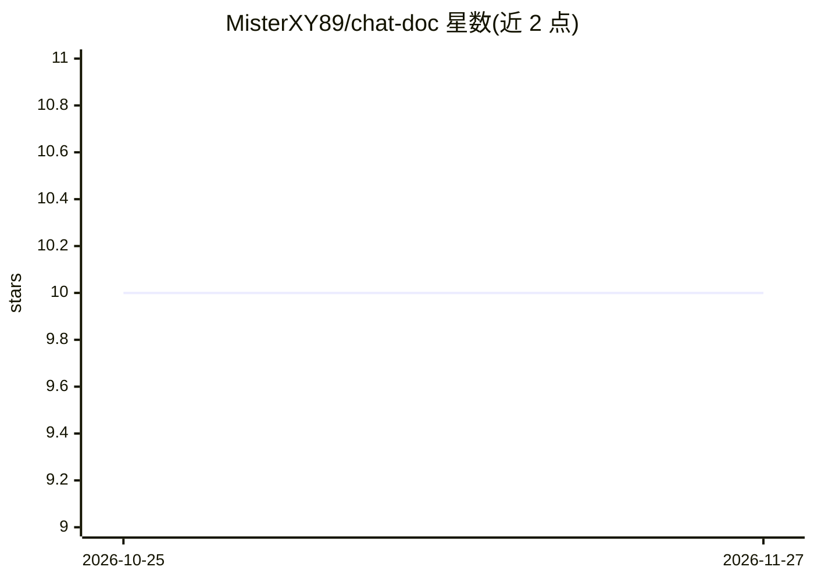

# MisterXY89/chat-doc

⭐ 10 · Jupyter Notebook · MIT · 推送 2026-06-01 · [GitHub](https://github.com/MisterXY89/chat-doc) · 个人维护

**面向医疗问诊场景微调 Llama-2 聊天机器人的端到端项目**

维也纳工业大学应用深度学习课程项目：用 QLoRA 技术在医疗对话/诊断数据集（pmc、icd、diagnose、med-dialogue 等）上微调 Llama-2，产出医疗症状评估聊天应用。提供 pipe.py CLI 完成数据生成、AWS SageMaker 训练与 Web 应用启动，微调后模型发布于 HuggingFace Model Hub（需申请访问权限），运行模型最低需要 24GB 显存的 GPU。前端依赖 npm 安装。

## 筛选速览

| 维度 | 判定 | 备注 |
|---|---|---|
| AI 角色 | `ai-native` | 本体是模型或模型工具 |
| 许可风险 | `permissive` | MIT |
| 部署形态 | `library` | 以包/库形式分发 |
| 模型依赖 | — | README 未给出锁定关系 |
| 硬件要求 | — | 无带数字的原话,不猜 |
| 安装摩擦 | `low` | 无编译、无系统依赖或容器化 |
| 成熟度 | — | 结构信号不足 |

## 能力要点

- QLoRA 微调 Llama-2 的完整流程：数据生成→SageMaker 训练→部署应用
- 支持多个医疗数据集（pmc/icd/diagnose/med-dialogue/dialogue-full/full）
- 微调后模型发布于 HuggingFace Model Hub，可用 transformers pipeline 加载
- 提供 Web 应用界面与训练结果日志

## 适用场景

- 复现医疗聊天机器人的 QLoRA 微调流程
- 在 AWS SageMaker 上跑 Llama-2 训练任务
- 加载微调后的医疗问诊模型做症状咨询

## 场景标签

`聊天机器人` `微调` · 领域:对话与助手

## 证据(README 行号)

> L11: The goal of this specific project is to fine-tune Llama2 model for a medical chat-application, a "Chat-Doc".
> L20: The ChatDoc project aims to deploy a medical chatbot application that assists users in assessing their medical symp

## 星数曲线

2026-10-25 10 → 2026-11-27 10（+0）

---
*卡片 v1 · prompt 1.4 · 生成 2026-11-20 · 置信度 high · 依据 README sha `fc34d4070f6c` · [字段定义](../../DATASET.md)*
