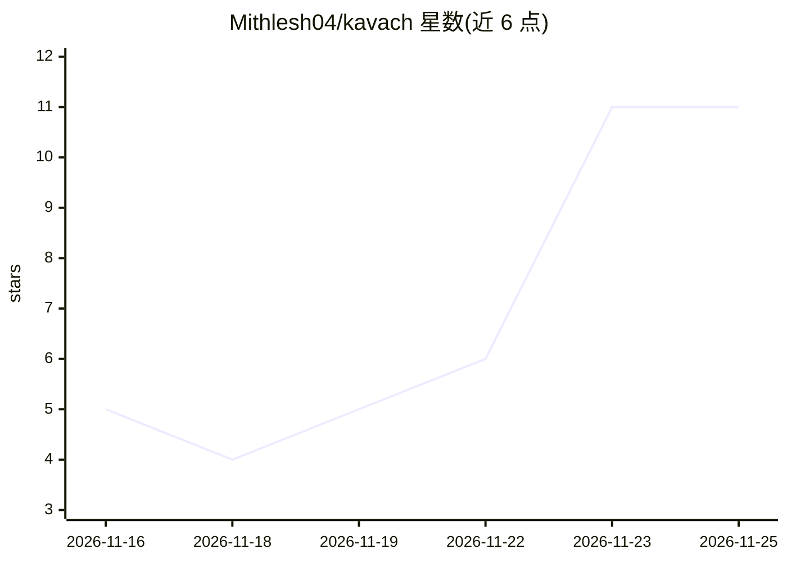

# Mithlesh04/kavach

⭐ 11 · Rust · Apache-2.0 · 推送 2026-11-23 · [GitHub](https://github.com/Mithlesh04/kavach) · [官网](https://kavachlang.com/) · 个人维护

**面向 AI 编程与 agent 的能力安全编程语言**

Kavach 是一门处于 pre-alpha 阶段的编程语言：函数与 agent 在签名中声明可触碰的资源（网络、文件、AI、支付），由编译器强制检查。编译到原生代码或 WASM，自带 agent guardrails（限额、人工审批、审计日志）、require/ensure 契约、基于类型与契约生成测试的 kavach test，以及供 AI 助手以低 token 查询编译器的 kavach query/mcp。仓库包含编译器、运行时、标准库、CLI 与 VS Code 扩展；语言规范为唯一权威来源，支持 1–7 章规范的程序可解释运行或编译。

## 筛选速览

| 维度 | 判定 | 备注 |
|---|---|---|
| AI 角色 | `ai-ecosystem` | LLM/agent 周边工具 |
| 许可风险 | `permissive` | Apache-2.0 |
| 部署形态 | `None` |  |
| 模型依赖 | — | README 未给出锁定关系 |
| 硬件要求 | — | 无带数字的原话,不猜 |
| 安装摩擦 | `low` | 无编译、无系统依赖或容器化 |
| 成熟度 | `idea` | |

## 能力要点

- 函数/agent 签名声明能力（网络、文件、AI、支付），编译器检查
- agent guardrails：限额、人工审批、审计日志内建于语言
- kavach test 从类型与契约生成测试并 fake 外部系统
- kavach query/mcp 供 AI 助手低 token 查询编译器

## 适用场景

- 编写会执行真实动作（付款、发消息）的 AI agent 并获得编译期能力约束
- AI 大量写代码的团队用语言机制约束代码行为
- 需要契约与自动生成测试的新语言项目

## 场景标签

 · 领域:编程语言/开发工具

## 证据(README 行号)

> L4: > A programming language that is **easy to write, fast to run, and safe for AI agents.**
> L19: - **Capabilities in the signature:** every function and agent declares what it can touch (network, files, AI, payme
> L23: - **Cheap for AI to work on:** AI assistants ask the compiler (`kavach query`, `outline`, `context`) instead of rea

## 星数曲线

2026-11-16 5 → 2026-11-25 11（+6）

---
*卡片 v1 · prompt 1.4 · 生成 2026-11-21 · 置信度 high · 依据 README sha `d409773d4340` · [字段定义](../../DATASET.md)*
