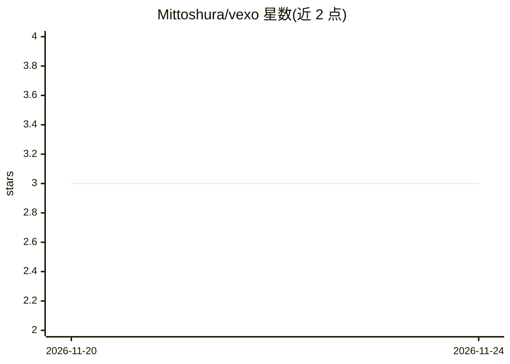

# Mittoshura/vexo

⭐ 3 · TypeScript · MIT · 推送 2026-11-15 · [GitHub](https://github.com/Mittoshura/vexo) · 个人维护

**本地批量发布工具：把 ComfyUI 生成的图自动发到多个艺术站**

一个本地运行的 Node.js 桌面应用，读取 ComfyUI/A1111 PNG 元数据中的 prompt、模型、LoRA 与 seed，支持批量编辑标题、标签与描述，自动识别 Danbooru 角色标签（英/日文）并按各站点字数限制生成标题，可排队与定时发布到 Pixiv、DeviantArt、Civitai、X、SubscribeStar。发布通过用户已登录的 Edge 浏览器会话完成，不使用 API key。仅支持 Windows 10/11；站点页面结构变更时对应适配器会失效。

## 筛选速览

| 维度 | 判定 | 备注 |
|---|---|---|
| AI 角色 | `ai-enhanced` | 去掉 AI 部分产品仍成立 |
| 许可风险 | `permissive` | MIT |
| 部署形态 | `None` |  |
| 模型依赖 | — | README 未给出锁定关系 |
| 硬件要求 | — | 无带数字的原话,不猜 |
| 安装摩擦 | `low` | 无编译、无系统依赖或容器化 |
| 成熟度 | — | 结构信号不足 |

## 能力要点

- 从 ComfyUI/A1111 PNG 元数据直接读取 prompt、模型、LoRA 与 seed
- 自动识别角色并生成英文/日文标签与各站点适配标题
- 通过已登录 Edge 会话发布，无 API key、数据全部留在本地
- 角色未成年风险提示机制（拉取 AniList 年龄与 Danbooru loli 占比）

## 适用场景

- 把一批 ComfyUI 生成图一次性发布到多个艺术平台
- 批量给图片补角色标签并按站点定制标题
- 定时排队发布并保留每条帖子的历史与重试记录

## 场景标签

`工作流自动化` `浏览器自动化` · 领域:效率与自动化

## 证据(README 行号)

> L3: **ComfyUI to every art site, on autopilot.** Batch-post your images to Pixiv, DeviantArt, Civitai, X and SubscribeSt
> L7: - Reads the prompt, model, LoRAs and seed straight from your ComfyUI / A1111 PNGs
> L65: 1. **Platforms** → *Log in* (Pixiv, DeviantArt, Civitai, X, SubscribeStar): an Edge window opens, log in, it closes

## 星数曲线

2026-11-20 3 → 2026-11-24 3（+0）

---
*卡片 v1 · prompt 1.4 · 生成 2026-11-22 · 置信度 mid · 依据 README sha `1ce36b4d0ffb` · [字段定义](../../DATASET.md)*
