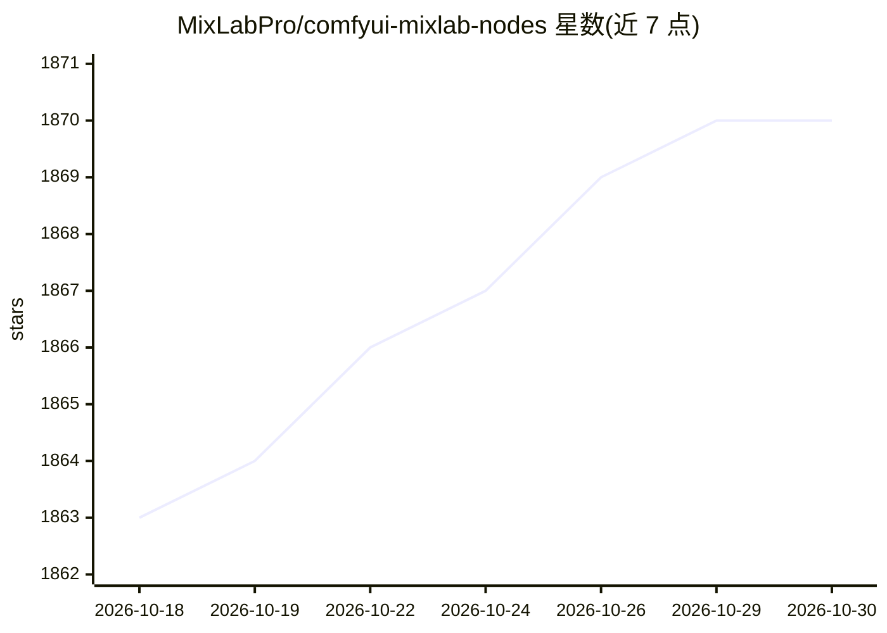

# MixLabPro/comfyui-mixlab-nodes

⭐ 1,870 · JavaScript · MIT · 推送 2026-06-04 · [GitHub](https://github.com/MixLabPro/comfyui-mixlab-nodes) · [官网](https://mixlabnodes.com) · 个人维护 · 中文 README

**ComfyUI 节点包：工作流转 Web App、GPT/语音/3D 等多类节点**

面向 ComfyUI 用户与工作流开发者的自定义节点集合，功能包括：通过 AppInfo 节点把 workflow 转为可切换的 Web App（支持 9 种输入节点、动态提示词）、ScreenShare/FloatingVideo 实时设计、语音识别与合成、多源 LLM 调用（本地 LLM、ChatGPT、ChatGLM3/4、Azure OpenAI、Siliconflow）、图像分层合成、3D（TripoSR）、MiniCPM-V 2.6 int4 视觉问答、rembg 抠图与 LaMa 修补等。安装方式为 clone 到 custom_nodes 目录并安装 requirements；部分模型需手动下载放置到指定目录。

## 筛选速览

| 维度 | 判定 | 备注 |
|---|---|---|
| AI 角色 | `ai-ecosystem` | LLM/agent 周边工具 |
| 许可风险 | `permissive` | MIT |
| 部署形态 | `desktop` | 安装包/桌面程序 |
| 模型依赖 | — | README 未给出锁定关系 |
| 硬件要求 | — | 无带数字的原话,不猜 |
| 安装摩擦 | `medium` | 含编译或系统依赖之一 |
| 成熟度 | — | 结构信号不足 |

## 能力要点

- AppInfo 节点把 ComfyUI workflow 转为可配置的 Web App
- 支持本地 LLM、ChatGPT、ChatGLM3/4、Azure OpenAI、Siliconflow 等多种 LLM 接入
- MiniCPM-V 2.6 int4 量化版视觉问答（约 7GB 显存）
- ScreenShare/FloatingVideo 实时屏幕捕捉配合 LCM-Lora

## 适用场景

- 把 ComfyUI 工作流发布成给他人使用的 Web 应用
- 在工作流中直接调用云端或本地 LLM 做 prompt 补全与对话
- 实时屏幕捕捉驱动的生成式设计实验

## 场景标签

`图像生成` `语音合成` `语音识别` · 领域:内容生成

## 证据(README 行号)

> L60: - 新增 AppInfo 节点，可以通过简单的配置，把 workflow 转变为一个 Web APP。
> L121: > Support for calling multiple GPTs.Local LLM 、 ChatGPT、ChatGLM3 、ChatGLM4 , Some code provided by rui. If you are

## 星数曲线

2026-10-18 1,863 → 2026-10-30 1,870（+7）

---
*卡片 v1 · prompt 1.4 · 生成 2026-10-21 · 置信度 mid · 依据 README sha `4510c7180eb1` · [字段定义](../../DATASET.md)*
