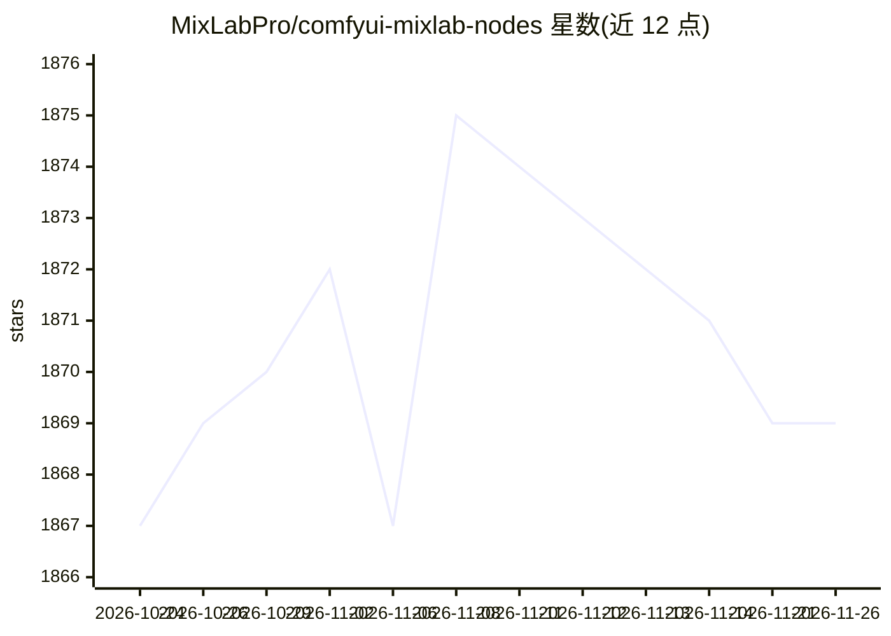

# MixLabPro/comfyui-mixlab-nodes

⭐ 1,869 · JavaScript · MIT · 推送 2026-11-24 · [GitHub](https://github.com/MixLabPro/comfyui-mixlab-nodes) · [官网](https://mixlabnodes.com) · 个人维护 · 中文 README

**ComfyUI 扩展节点集：把工作流转为 Web App 并接入 LLM/语音/3D**

面向 ComfyUI 用户的节点扩展包，提供 Workflow-to-APP（AppInfo 节点把工作流配置为 Web App，支持多 App 切换、批量提示词、动态提示）、屏幕捕获与浮动视频节点（配合 LCM-Lora）、语音识别与合成、GPT 类文本节点，以及图层、抠图、inpainting、图像批量加载等节点。通过 git clone 安装到 custom_nodes 目录并 pip 安装 requirements。部分模型（TripoSR、rembg、lama 等）需手动下载放置；LaMaInpainting 需手动安装依赖。

## 筛选速览

| 维度 | 判定 | 备注 |
|---|---|---|
| AI 角色 | `ai-ecosystem` | LLM/agent 周边工具 |
| 许可风险 | `permissive` | MIT |
| 部署形态 | `desktop` | 安装包/桌面程序 |
| 模型依赖 | — | README 未给出锁定关系 |
| 硬件要求 | — | 无带数字的原话,不猜 |
| 安装摩擦 | `medium` | 含编译或系统依赖之一 |
| 成熟度 | — | 结构信号不足 |

## 能力要点

- AppInfo 节点把 workflow 转为 Web App，支持多 App 切换与批量提示词
- ScreenShareNode/FloatingVideoNode 捕获屏幕像素流，配合 LCM-Lora 实时生成
- GPT 节点支持本地 LLM、ChatGPT、ChatGLM3/4、Azure OpenAI 多种调用方式
- 提供语音识别/合成、3D（TripoSR）、抠图（rembg）、LaMa inpainting 等节点

## 适用场景

- 把 ComfyUI 工作流发布为可分享的 Web App
- 在 ComfyUI 中调用本地或云端 LLM 做 prompt 补全
- 屏幕共享实时进行 LCM-Lora 设计生成
- 中文书写 prompt 并生成图像

## 场景标签

`图像生成` `语音合成` `语音识别` · 领域:内容生成

## 证据(README 行号)

> L58: ## 🚀🚗🚚🏃 Workflow-to-APP
> L121: > Support for calling multiple GPTs.Local LLM 、 ChatGPT、ChatGLM3 、ChatGLM4 , Some code provided by rui. If you are
> L284: manually install, simply clone the repo into the custom_nodes directory with this command:

## 星数曲线

2026-10-24 1,867 → 2026-11-26 1,869（+2）

---
*卡片 v1 · prompt 1.4 · 生成 2026-11-26 · 置信度 mid · 依据 README sha `e56c914a765b` · [字段定义](../../DATASET.md)*
