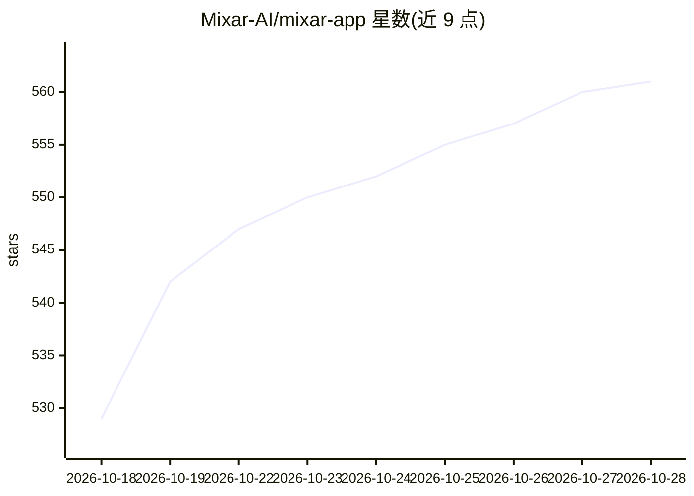

# Mixar-AI/mixar-app

⭐ 562 · Python · GPL-3.0 · 推送 2026-10-28 · [GitHub](https://github.com/Mixar-AI/mixar-app) · [官网](https://www.mixar.app) · 组织维护

**带 AI 助手与生成工具的 Blender 定制桌面应用（3D 创作套件）**

Mixar 是基于 Blender 5.2 的定制分支桌面应用，在保留 Blender 全部原有功能（雕刻、动画、渲染、脚本等）之外增加：可规划并执行多步场景任务的聊天 Agent Mixie、Photoshop 式分层纹理绘制、text-to-3D / image-to-3D 生成（接入 Hunyuan 等模型）、情绪板与场景生成、资产神经嵌入搜索，以及 BYOK 模式路由自有 OpenAI/Anthropic 等 key。AI 功能依赖 Mixar 托管的闭源后端并需账号登录；非 AI 部分（Blender 功能、分层绘制、文件 IO）无需账号即可使用。源码 GPL-3.0-or-later，仅提供从源码构建，无预编译安装包；后端不开源。

## 筛选速览

| 维度 | 判定 | 备注 |
|---|---|---|
| AI 角色 | `ai-enhanced` | 去掉 AI 部分产品仍成立 |
| 许可风险 | `viral` | GPL-3.0 |
| 部署形态 | `library` | 以包/库形式分发 |
| 模型依赖 | — | README 未给出锁定关系 |
| 硬件要求 | — | 无带数字的原话,不猜 |
| 安装摩擦 | `high` | 编译与系统依赖俱全 |
| 成熟度 | — | 结构信号不足 |

## 能力要点

- 聊天 Agent Mixie 可对场景执行多步任务（建模、贴图、材质、修 UV）
- 分层纹理绘制系统（图层、遮罩、UDIM、烘焙、贴花、资产导出）
- text-to-3D / image-to-3D 生成，含重拓扑与自动 UV 展开
- BYOK：可接自有 OpenAI / Anthropic 等 provider key，不消耗 Mixar 积分

## 适用场景

- 在熟悉的 Blender 工作流中用对话式 AI 助手完成建模与贴图
- 通过文字或图片参考生成 3D 网格并自动处理拓扑与 UV
- 用分层图层系统绘制纹理并导出资产

## 场景标签

`语义搜索` · 领域:知识与检索

## 证据(README 行号)

> L3: Mixar is an AI-powered 3D content creation tool built as a custom fork of Blender 5.2. It adds an AI chat agent that
> L21: The Blender features you already know (sculpting, animation, simulation, rendering, scripting) are unchanged and av
> L31: The non-AI parts of the app (Blender features, the layered paint module, file IO, etc.) work without a Mixar accoun

## 星数曲线

2026-10-18 529 → 2026-10-28 561（+32）

---
*卡片 v1 · prompt 1.4 · 生成 2026-10-21 · 置信度 mid · 依据 README sha `1574c2583b74` · [字段定义](../../DATASET.md)*
