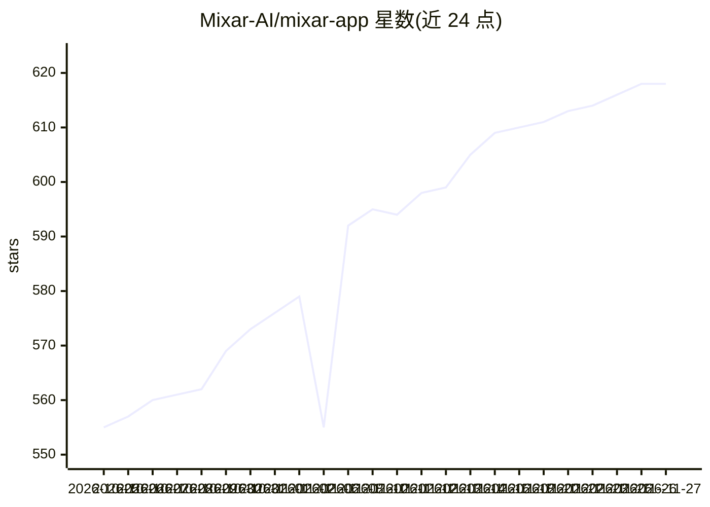

# Mixar-AI/mixar-app

⭐ 618 · Python · GPL-3.0 · 推送 2026-11-26 · [GitHub](https://github.com/Mixar-AI/mixar-app) · [官网](https://www.mixar.app) · 组织维护

**基于 Blender 的 AI 3D 创作：对话代理驱动建模与纹理**

Blender 5.3 的定制 fork 桌面应用，保留 Blender 原有功能（雕刻、动画、渲染等），叠加：可规划执行多步任务的聊天代理 Mixie、Photoshop 式分层纹理绘制系统、text-to-3D/image-to-3D 网格生成（含重拓扑与自动 UV）、moodboard 场景生成与神经嵌入资产搜索。AI 功能需账号调用官方托管后端，也可 BYOK 接自有 API key；非 AI 部分无需账号。README 仅提供源码构建路径，托管后端闭源不包含在内。

## 筛选速览

| 维度 | 判定 | 备注 |
|---|---|---|
| AI 角色 | `ai-native` | 本体是模型或模型工具 |
| 许可风险 | `viral` | GPL-3.0 |
| 部署形态 | `desktop` | 安装包/桌面程序 |
| 模型依赖 | — | README 未给出锁定关系 |
| 硬件要求 | `cpu-ok` | |
| 安装摩擦 | `high` | 编译与系统依赖俱全 |
| 成熟度 | `idea` | |

## 能力要点

- 聊天代理可规划并执行多步场景任务（建模、绘制纹理、修 UV）
- 分层纹理绘制：节点材质、遮罩、UDIM、程序化材质与烘焙
- text-to-3D / image-to-3D 生成，集成 Hunyuan 等模型
- BYOK 支持接入自有 OpenAI/Anthropic API key

## 适用场景

- 用提示词生成 3D 网格并自动重拓扑和 UV 展开
- 以分层方式绘制与管理纹理材质并导出资产
- 通过对话让 AI 代理代为执行 Blender 场景操作
- 对本地资产库做语义搜索

## 场景标签

 · 领域:3D 内容创作工具

## 证据(README 行号)

> L3: Mixar is an AI-powered 3D content creation tool built as a custom fork of Blender 5.3. It adds an AI chat agent that
> L13: - **AI agent chat** — Mixie, an in-app chat agent that can plan and execute multi-step tasks against your scene: mo
> L15: - **AI 3D generation** — text-to-3D and image-to-3D mesh generation via integrated providers (Hunyuan models and ot

## 星数曲线

2026-10-25 555 → 2026-11-27 618（+63）

---
*卡片 v1 · prompt 1.4 · 生成 2026-11-25 · 置信度 mid · 依据 README sha `92e1847b67bb` · [字段定义](../../DATASET.md)*
