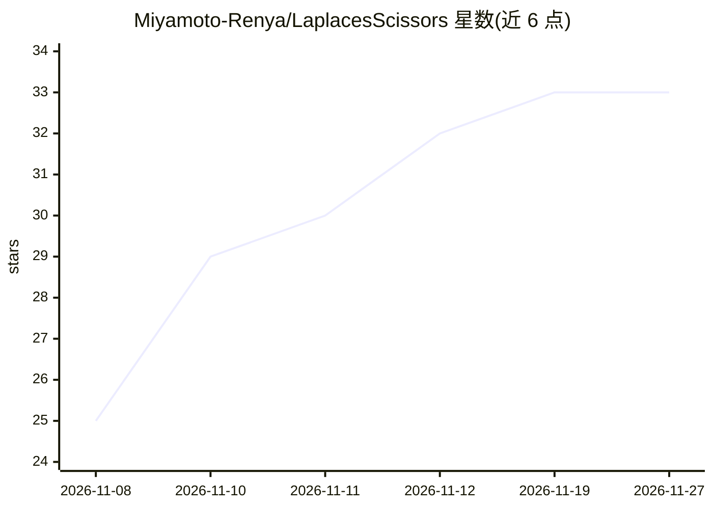

# Miyamoto-Renya/LaplacesScissors

⭐ 33 · Rust · MIT · 推送 2026-11-09 · [GitHub](https://github.com/Miyamoto-Renya/LaplacesScissors) · 个人维护

**开源 LLM 输出矩阵诊断与修正研究工具（Rust+Triton）**

面向机制可解释性与模型编辑研究的 CLI 工具：从 Hugging Face 或本地 safetensors 加载模型，用 probe 命令以数值注入追踪弱判别方向，用 diagnose 命令基于正答案例计算受保护的 readout 旋转，在修正失败回答的同时保持已成功生成的输出不变，并导出编辑后的 checkpoint。支持 scale 命令跨规模系列应用同一编辑策略分析损失曲线与偏差恢复。实现采用 Rust 负责模型加载与执行、Python 提供 Triton 编译桥接，运行于 CUDA/HIP GPU。支持范围限于标准 dense decoder 架构（GQA、RMSNorm/LayerNorm、RoPE、gated MLP、线性 readout），需自行编译且依赖 GPU 驱动。

## 筛选速览

| 维度 | 判定 | 备注 |
|---|---|---|
| AI 角色 | `ai-ecosystem` | LLM/agent 周边工具 |
| 许可风险 | `permissive` | MIT |
| 部署形态 | `None` |  |
| 模型依赖 | — | README 未给出锁定关系 |
| 硬件要求 | — | 无带数字的原话,不猜 |
| 安装摩擦 | `high` | 编译与系统依赖俱全 |
| 成熟度 | — | 结构信号不足 |

## 能力要点

- 受保护 readout 旋转：修正错误答案同时锁定已成功生成的输出
- probe 数值注入追踪弱判别方向（Jeffreys 对称 KL 判别度）
- 导出编辑后 checkpoint（FP32 lm_head、解除 embedding 共享）
- scale 命令按幂律曲线分析跨规模编辑偏差与权重贡献

## 适用场景

- 研究 LLM 输出方向的弱判别能力并定位问题权重坐标
- 在不破坏已有正确行为的前提下修正特定失败回答
- 跨模型规模分析编辑策略的损失曲线与偏差恢复量

## 场景标签

`科研工具` · 领域:学习与行业

## 证据(README 行号)

> L13: **Rotate an LLM’s output matrix so protected answers stay fixed while failed answers are repaired.**
> L33: |`probe`|수치 입력에서 약한 구별 방향을 추적 Trace weak discrimination directions|층별 상쇄, 좌표 기여, 보호 회전 Layer cancellation, coordina
> L34: |`diagnose`|정답 사례로 출력 회전을 계산 Repair outputs from expected answers|GPU로 확인한 후보와 채택 수정안 GPU-checked candidates and th

## 星数曲线

2026-11-08 25 → 2026-11-27 33（+8）

---
*卡片 v1 · prompt 1.4 · 生成 2026-11-18 · 置信度 high · 依据 README sha `4db2f229c43a` · [字段定义](../../DATASET.md)*
