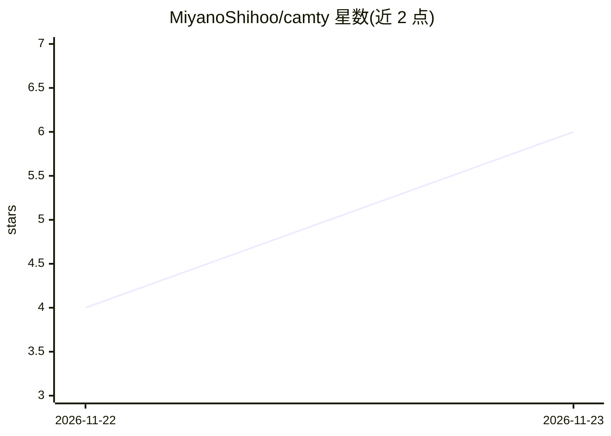

# MiyanoShihoo/camty

⭐ 6 · Python · Apache-2.0 · 推送 2026-11-19 · [GitHub](https://github.com/MiyanoShihoo/camty) · 个人维护 · 中文 README

**给红队/安全测试者的全链渗透测试自动化工作台**

将渗透测试的侦察测绘、漏洞验证、权限提升、横向移动、证据归档、报告生成纳入同一条流水线：范围白名单 deny-by-default、JSONL 审计哈希链防篡改、利用级动作须引用已验证发现（finding-ID 门控）。提供 41 个结构化适配器（对接 subfinder/httpx/nuclei/fscan/impacket 等）、C2 三件套与自研植入体。LLM 规划者读台账生成攻击链 todolist，worker 并行执行，失败可降级为确定性模式，支持人在环路转向。仅限已获书面授权的测试使用。

## 筛选速览

| 维度 | 判定 | 备注 |
|---|---|---|
| AI 角色 | `ai-enhanced` | 去掉 AI 部分产品仍成立 |
| 许可风险 | `permissive` | Apache-2.0 |
| 部署形态 | `library` | 以包/库形式分发 |
| 模型依赖 | — | README 未给出锁定关系 |
| 硬件要求 | — | 无带数字的原话,不猜 |
| 安装摩擦 | `low` | 无编译、无系统依赖或容器化 |
| 成熟度 | — | 结构信号不足 |

## 能力要点

- 审计哈希链与证据台账：每步动作可回放、可交付
- 41 个结构化适配器，外部工具与自研武器输出自动进台账
- LLM 规划者 + 多 worker 引擎，断点续跑、连续失败自动降级确定性模式
- HTML/docx/SRC 三态报告与 IM 推送（飞书/钉钉/企微/TG）

## 适用场景

- 已授权的渗透测试项目从侦察到报告的全链自动化
- 红队交战中强制范围护栏与破坏性动作门控
- 用 Web 面板回放流量、查看资产覆盖图与审批队列

## 场景标签

`多智能体` `网络安全` · 领域:Agent 开发

## 证据(README 行号)

> L29: LLM 规划者读台账与资产覆盖度生成攻击链 todolist，N 个 worker 并行领意图执行并写回；资产图（真值库 + 覆盖度）与探索图（意图血缘）断点续跑；限流退避、连续失败自动降级确定性模式、人在环路随时转向。
> L16: Camty 是一套**可审计的红队交战工作台**：把一次渗透测试的全部动作——侦察测绘、漏洞验证、权限提升、横向移动、证据归档、报告生成——纳入同一条流水线，用范围护栏、审计哈希链和证据台账保证**每一步都合规、可回放、可交付**

## 星数曲线

2026-11-22 4 → 2026-11-23 6（+2）

---
*卡片 v1 · prompt 1.4 · 生成 2026-11-22 · 置信度 mid · 依据 README sha `a8c7d66508e3` · [字段定义](../../DATASET.md)*
