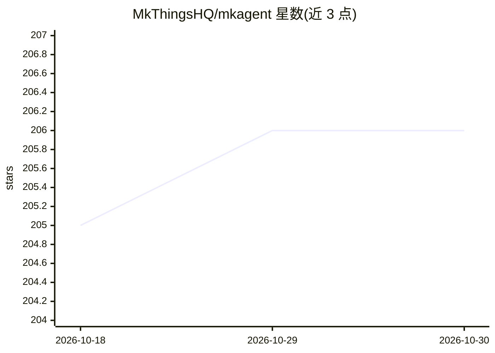

# MkThingsHQ/mkagent

⭐ 206 · TypeScript · Apache-2.0 · 推送 2026-10-26 · [GitHub](https://github.com/MkThingsHQ/mkagent) · [官网](https://mkagent.app) · 个人维护 · 中文 README

**本地优先的 AI agent 工作台，覆盖桌面/WebUI/CLI**

基于 Pi agent 运行时的开源 AI agent 工作台，提供 Electron 桌面端、浏览器 WebUI 与 CLI 三种使用界面，共享同一运行时。功能包括本地持久化工作区、会话分支与计划、浏览器工具、文档工具，模型接入支持订阅账号（ChatGPT Plus、Claude Pro/Max）、API key、OpenAI/Anthropic 兼容端点及本地 Ollama。应用状态存于本地数据目录，凭据经操作系统凭据管理器存储。源码运行需 Bun 1.3.14+、Node.js 18+。

## 筛选速览

| 维度 | 判定 | 备注 |
|---|---|---|
| AI 角色 | `ai-native` | 本体是模型或模型工具 |
| 许可风险 | `permissive` | Apache-2.0 |
| 部署形态 | `None` |  |
| 模型依赖 | local-ok | 支持本地模型 |
| 硬件要求 | — | 无带数字的原话,不猜 |
| 安装摩擦 | `low` | 无编译、无系统依赖或容器化 |
| 成熟度 | — | 结构信号不足 |

## 能力要点

- Desktop/WebUI/CLI 三界面共享同一 Pi 运行时
- 本地持久化工作区与操作系统凭据管理器存储凭据
- 模型接入含订阅账号、OpenAI/Anthropic 兼容端点与本地 Ollama
- Explore/Ask/Execute 三档权限模式与中英双语界面

## 适用场景

- 在本地管理工作区、会话与文件，运行 AI agent 任务
- 通过桌面端、浏览器或命令行远程控制同一 agent 运行时
- 接入本地 Ollama 模型离线使用 agent 功能
- 基于其开源基础构建自定义桌面 agent 产品

## 场景标签

`Agent 框架` `AI 助手` `浏览器自动化` · 领域:Agent 开发

## 证据(README 行号)

> L18: MkAgent is an open-source, local-first AI agent workspace for anyone who wants more control over
> L20: foundation to build your own desktop agent product. Powered by the
> L21: Pi agent runtime, it combines persistent local workspaces,

## 星数曲线

2026-10-18 205 → 2026-10-30 206（+1）

---
*卡片 v1 · prompt 1.4 · 生成 2026-10-22 · 置信度 high · 依据 README sha `cd59f95a3c1e` · [字段定义](../../DATASET.md)*
