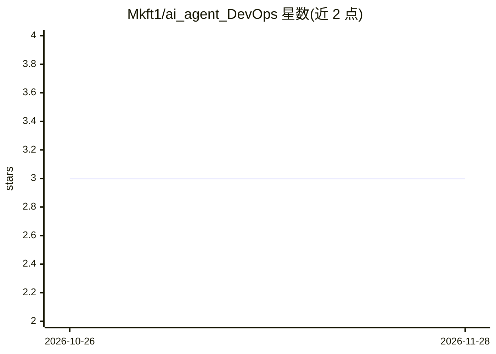

# Mkft1/ai_agent_DevOps

⭐ 3 · Python · MIT · 推送 2026-11-03 · [GitHub](https://github.com/Mkft1/ai_agent_DevOps) · 个人维护 · 中文 README

**为 on-call 工程师诊断 Kubernetes 事故的只读 LLM Agent**

以 FastAPI 服务形式部署的 SRE 诊断 Agent：接收 Alertmanager webhook 或 REST 调用，读取 pod 状态、事件、Prometheus 指标与容器日志，结合本地 Markdown runbook 的混合检索（TF-IDF + sentence-transformers 嵌入，无向量库），生成结构化 RCA 报告并推送 Slack/Telegram。默认只读（ENABLE_WRITE_ACTIONS=false），内置命名空间白名单、危险操作两级审批、PII 脱敏、OIDC JWT 认证与审计日志。另提供 Helm chart、Streamlit 审批看板、480 个测试与离线评测框架。

## 筛选速览

| 维度 | 判定 | 备注 |
|---|---|---|
| AI 角色 | `ai-native` | 本体是模型或模型工具 |
| 许可风险 | `permissive` | MIT |
| 部署形态 | `self-host` | docker 或自建部署 |
| 模型依赖 | local-ok | 支持本地模型 |
| 硬件要求 | — | 无带数字的原话,不猜 |
| 安装摩擦 | `low` | 无编译、无系统依赖或容器化 |
| 成熟度 | — | 结构信号不足 |

## 能力要点

- 只读默认模式 + 危险操作 requires_approval 人工审批路由
- 混合 RAG：0.5×TF-IDF + 0.5×本地嵌入，模型不可用时降级为纯 TF-IDF
- PII/密钥在调用 LLM 前脱敏为 [REDACTED:<type>]
- OpenTelemetry 追踪与 LLM 成本（FinOps）指标

## 适用场景

- 接入 Alertmanager 后自动对 firing 告警生成根因分析报告
- 在只读模式下接入生产告警管道辅助 on-call 排障
- 用审批看板审核并批准高危修复建议
- 运行 chaos_test 脚本自测诊断能力

## 场景标签

`RAG` · 领域:知识与检索

## 证据(README 行号)

> L17: An LLM-powered SRE agent that diagnoses Kubernetes incidents end-to-end. It ingests alerts via a REST API, correlat
> L25: |🧠 **LLM RCA**|OpenAI-compatible chat API (Qwen/DashScope by default) with strict JSON output validated by Pydantic
> L51: `Alertmanager → POST /diagnose → IncidentOrchestrator → [K8sTools, PrometheusTools, LogsTools] → RunbookRAG → LLM →

## 星数曲线

2026-10-26 3 → 2026-11-28 3（+0）

---
*卡片 v1 · prompt 1.4 · 生成 2026-11-22 · 置信度 high · 依据 README sha `7f0bdeadf576` · [字段定义](../../DATASET.md)*
