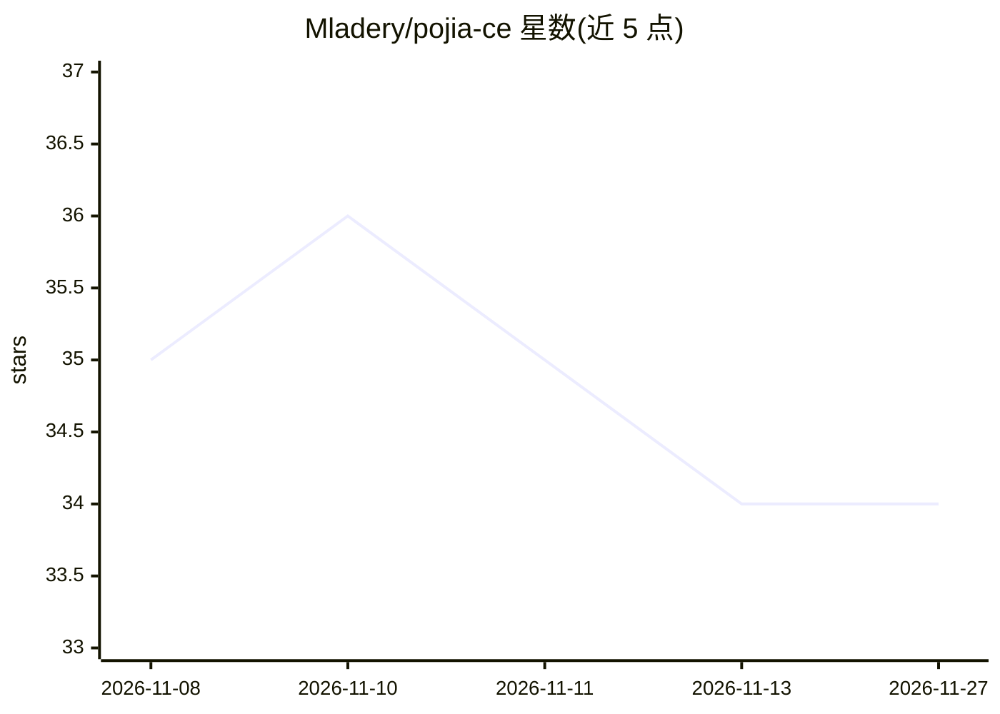

# Mladery/pojia-ce

⭐ 34 · 推送 2026-11-07 · [GitHub](https://github.com/Mladery/pojia-ce) · [官网](https://github.com/Mladery/pojia-modifier) · 个人维护 · 中文 README

**已停用仓库：仅保留跳转到新项目的转移说明**

该仓库已停止维护，README 仅为转移声明：指引用户前往新仓库 Mladery/pojia-modifier（破甲修改器 1.0，MIT 许可）。原提交历史、v8.5-CE 至 v8.65-CE 全部标签与源码均已移除，本文件是仓库唯一内容；代码、issue、pull request 一律走新仓库，已有 fork 属第三方。主题标签含 ai-agent、claude-code、cursor、deepseek-harness 等，但本仓库无任何可用代码或功能说明。

## 筛选速览

| 维度 | 判定 | 备注 |
|---|---|---|
| AI 角色 | `ai-enhanced` | 去掉 AI 部分产品仍成立 |
| 许可风险 | `none` | — |
| 部署形态 | `None` |  |
| 模型依赖 | — | README 未给出锁定关系 |
| 硬件要求 | — | 无带数字的原话,不猜 |
| 安装摩擦 | `low` | 无编译、无系统依赖或容器化 |
| 成熟度 | — | 结构信号不足 |

## 能力要点

- 仅含转移声明，指向新仓库 Mladery/pojia-modifier
- 原源码与标签（v8.5-CE 至 v8.65-CE）已从本仓库移除
- 声明已有 fork 属第三方，与本项目无关

## 适用场景

- 通过本页找到项目的新地址
- 确认旧仓库不再接受提交

## 场景标签

 · 领域:游戏工具（据主题标签推断）

## 证据(README 行号)

> L5: `Mladery/pojia-ce` 不再维护。仓库的提交历史、全部标签（`v8.5-CE` … `v8.65-CE`）与源码已移除，
> L9: - 当前版本：破甲修改器 1.0

## 星数曲线

2026-11-08 35 → 2026-11-27 34（-1）

---
*卡片 v1 · prompt 1.4 · 生成 2026-11-18 · 置信度 low · 依据 README sha `fff5058719ff` · [字段定义](../../DATASET.md)*
