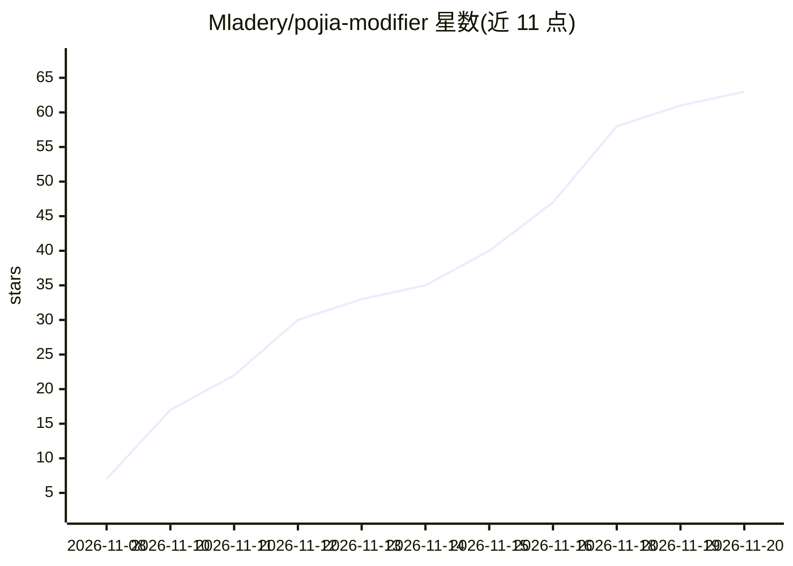

# Mladery/pojia-modifier

⭐ 63 · Python · NOASSERTION · 推送 2026-11-14 · [GitHub](https://github.com/Mladery/pojia-modifier) · 个人维护 · 中文 README

**批量替换 20 个 AI 客户端内置提示词为自定义人格的跨平台工具**

命令行/图形界面的本机文本替换工具：定位本机安装的 20 个 AI 客户端（DeepSeek Harness、WorkBuddy、Claude Code、Cursor、Qwen Code 等）的提示词/规则文件，替换为用户指定的人格文本，改前旁路备份，--revert 一键还原；核心流程离线、不修改软件本体、不写注册表。提供 --dry-run 预演、固定口令自证载入、本机网页 UI 与 exe 签名校验。限制：仅限自己有权管理的设备，目标客户端更新可能失效；macOS 需处理签名失效。主程序零第三方依赖，Windows/Linux/macOS 提供安装包与免安装 exe。

## 筛选速览

| 维度 | 判定 | 备注 |
|---|---|---|
| AI 角色 | `ai-ecosystem` | LLM/agent 周边工具 |
| 许可风险 | `permissive` | NOASSERTION |
| 部署形态 | `desktop` | 安装包/桌面程序 |
| 模型依赖 | — | README 未给出锁定关系 |
| 硬件要求 | — | 无带数字的原话,不猜 |
| 安装摩擦 | `low` | 无编译、无系统依赖或容器化 |
| 成熟度 | `idea` | |

## 能力要点

- 支持 20 个 AI 客户端的提示词统一注入，共用一份人格文本
- --dry-run 预演、改前旁路备份、--revert 一键还原官方原版
- 核心流程全程离线，联网仅限 fetch-tools/git-bash/update 三处且可关
- 命令行主程序零第三方依赖，附带 exe 证书签名与 SHA256 校验通道

## 适用场景

- 给本机多个 AI 客户端统一换成自己写的身份设定
- 改前先 dry-run 看会动哪些文件，改完用固定口令验证人格载入
- 客户端行为异常时用 --revert 还原官方原版

## 场景标签

`提示工程` · 领域:Agent 开发

## 证据(README 行号)

> L12: **一句话：把你电脑上 20 个 AI 客户端「自己改不到的内置提示词」，换成你自己写的那份。**
> L21: > 它**不修改软件本体**：只做文本文件层面的替换。破甲流程不删包、不写注册表、不装服务（为了定位安装目录，会读一次卸载表与 `App Paths`，只读不写）；全程不发任何网络请求（联网只发生在你主动用 `--fetch-to

## 星数曲线

2026-11-08 7 → 2026-11-20 63（+56）

---
*卡片 v1 · prompt 1.4 · 生成 2026-11-18 · 置信度 mid · 依据 README sha `fefb38e8b7b2` · [字段定义](../../DATASET.md)*
