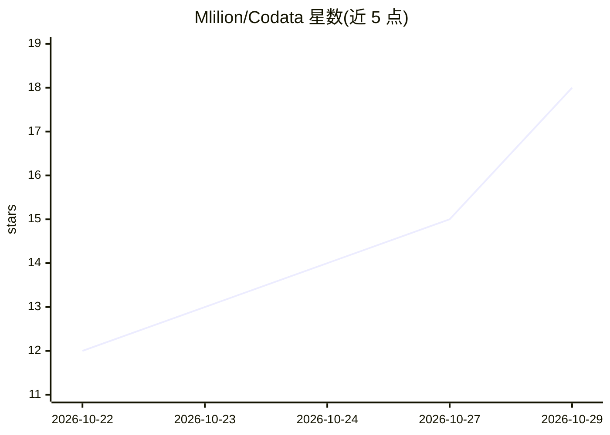

# Mlilion/Codata

⭐ 18 · Python · Apache-2.0 · 推送 2026-10-28 · [GitHub](https://github.com/Mlilion/Codata) · 个人维护 · 中文 README

**本地优先的桌面 Data Agent：自然语言查数、SQL、看板与专家团分析**

开源本地优先的桌面数据分析工作区，由 Tauri 外壳、Next.js 前端和 FastAPI 后端组成。用户用自然语言提问，Agent 发现表与指标口径、生成或复用 SQL、执行查询、展示结果卡片与图表并沉淀到看板；复杂问题可交给多 Agent 专家团（sequential/workflow/hierarchical 三种模式）拆解为数据发现、SQL、归因、可视化等步骤。面向分析师和业务团队。模型与 MCP 数据源均由用户自行配置，支持 OpenAI-compatible、自定义 endpoint 或本地 Ollama；本地优先但非完全离线，云模型与外部连接器会外发上下文。Linux 版尚未完成发布验收。

## 筛选速览

| 维度 | 判定 | 备注 |
|---|---|---|
| AI 角色 | `ai-native` | 本体是模型或模型工具 |
| 许可风险 | `permissive` | Apache-2.0 |
| 部署形态 | `desktop` | 安装包/桌面程序 |
| 模型依赖 | local-ok | 支持本地模型 |
| 硬件要求 | — | 无带数字的原话,不猜 |
| 安装摩擦 | `low` | 无编译、无系统依赖或容器化 |
| 成熟度 | `idea` | |

## 能力要点

- 自然语言查数链路：schema 检查→指标检索→SQL 生成→执行→图表→看板
- 多 Agent 专家团编排，支持 sequential/workflow/hierarchical 三种执行模式
- 指标口径约束：优先注册指标定义，无权威口径时显式标注自定义
- 本地优先存储：对话、看板、记忆、artifact 默认存本机

## 适用场景

- 业务团队用自然语言查询数据库并核验 SQL 与口径来源
- 把有价值的分析图表沉淀为可刷新的看板
- 用多专家协作流程完成归因、异常定位等复杂分析
- 通过飞书/钉钉/企业微信在聊天中使用分析能力

## 场景标签

`数据分析` `多智能体` · 领域:Agent 开发

## 证据(README 行号)

> L25: Codata 是一个开源、本地优先的桌面 Data Agent 工作区。它把本地桌面应用、Next.js 前端和 FastAPI Agent 后端组合在一起，让分析师和业务团队可以用自然语言提出数据问题，由 Agent 发现表和指
> L40: - **自然语言数据分析**：直接问“按渠道对比付费转化率”或“找出本周最大异常下滑”。

## 星数曲线

2026-10-22 12 → 2026-10-29 18（+6）

---
*卡片 v1 · prompt 1.4 · 生成 2026-10-29 · 置信度 high · 依据 README sha `3d30be79af75` · [字段定义](../../DATASET.md)*
