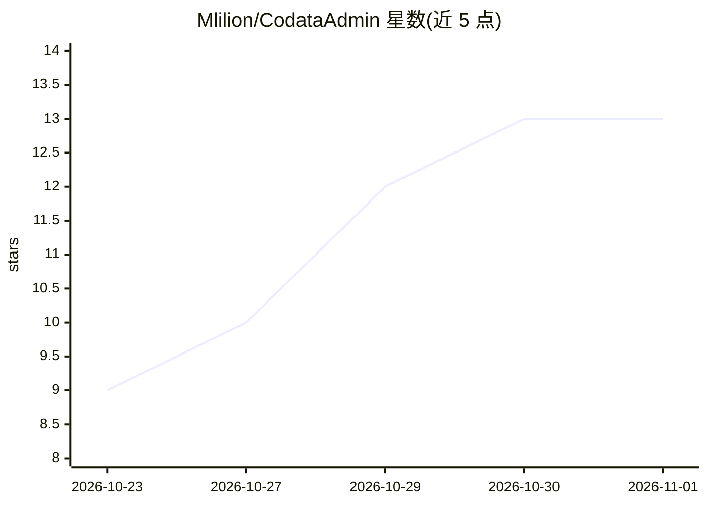

# Mlilion/CodataAdmin

⭐ 13 · Python · GPL-3.0 · 推送 2026-10-22 · [GitHub](https://github.com/Mlilion/CodataAdmin) · 个人维护 · 中文 README

**面向 AI Agent 的语义治理与可信取数平台，经 MCP 提供口径背书的取数**

Codata 项目的语义模型配套仓库：把物理数仓建模为 L1–L6 分层语义本体（物理目录→业务域/实体/字段→JOIN→维度→指标→知识），通过完整度检查、口径审核与发布门禁生成带 checksum 的版本化快照，再经 MCP Server（list_models/search_semantic/get_model_context/query_indicator）让 AI Agent 在不写 SQL、不猜口径的前提下取数。主库默认 MySQL 8，检索副库为可选 PostgreSQL+pgvector，提供 FastAPI 后端与 Vue 3 前端的 Web 管理台。语义检索、向量嵌入、DataCatalog 同步与 MCP 均为可选能力。

## 筛选速览

| 维度 | 判定 | 备注 |
|---|---|---|
| AI 角色 | `ai-ecosystem` | LLM/agent 周边工具 |
| 许可风险 | `viral` | GPL-3.0 |
| 部署形态 | `library` | 以包/库形式分发 |
| 模型依赖 | — | README 未给出锁定关系 |
| 硬件要求 | — | 无带数字的原话,不猜 |
| 安装摩擦 | `low` | 无编译、无系统依赖或容器化 |
| 成熟度 | — | 结构信号不足 |

## 能力要点

- L1–L6 分层语义本体建模，指标口径需审核通过才进发布快照
- MCP 工具链 list_models→search_semantic→get_model_context→query_indicator，execute_sql 默认关闭
- 四级分级检索（精确/模糊/全文/向量）与确定性意图校验规则（维度白名单、枚举值域、时间窗、口径分水岭）
- 跨实体下钻对 fanout/不可分解场景显式拒绝，越权统一返回 model_forbidden

## 适用场景

- 为企业数仓建立统一指标口径，供 AI Agent 可信取数
- 通过 MCP 让 Agent 按已审核口径查数并携带口径声明
- 治理物理表变更对语义资产的影响，做发布前门禁与就绪自检

## 场景标签

`数据分析` `语义搜索` · 领域:效率与自动化

## 证据(README 行号)

> L3: > 企业级语义治理与可信取数平台：把物理数仓建模为分层语义本体，经人工审核与发布快照后，通过 MCP 向 AI Agent 提供有口径背书的取数能力。
> L23: **物理目录 → 分层语义本体 → 语义模型组装 → 发布快照 → 检索索引 → MCP 取数 → 审计闭环**
> L133: ## MCP 工具

## 星数曲线

2026-10-23 9 → 2026-11-01 13（+4）

---
*卡片 v1 · prompt 1.4 · 生成 2026-10-31 · 置信度 mid · 依据 README sha `0180e694a04f` · [字段定义](../../DATASET.md)*
