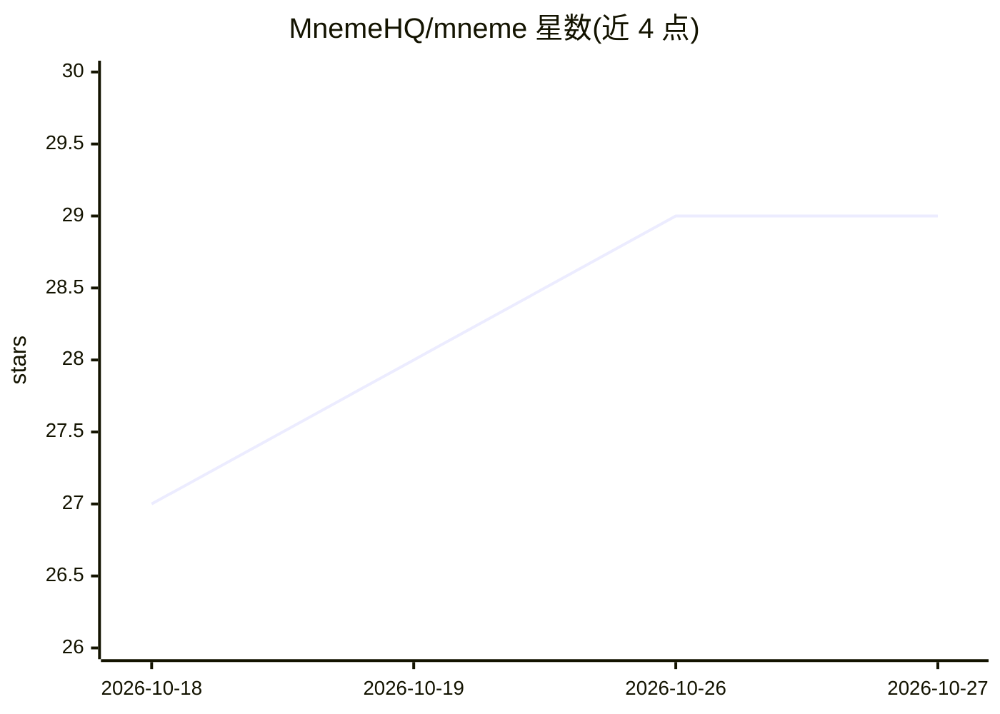

# MnemeHQ/mneme

⭐ 29 · Python · MIT · 推送 2026-10-26 · [GitHub](https://github.com/MnemeHQ/mneme) · [官网](https://mnemehq.com) · 组织维护

**面向 agentic 软件开发的决策与控制层：防止架构漂移**

Mneme 将架构决策与 ADR 转化为结构化治理记录，在 AI 编码代理、仓库变更与 CI 门禁中提供确定性的 guide/warn/block 判定，防止架构漂移。核心机制：结构化决策语料库、决策检索与执行分离、本地 MCP 服务器（六个冻结工具，仅提案与读取、不授予权威）、Architecture Audit（判定决策属于 Protected/Mneme-ready/Requires modelling/Guidance）、CLI 严格模式给出可复现的 PASS/FAIL 退出码，不依赖 LLM 裁决。原生集成 Claude Code、Codex CLI 等表面，支持 GitHub Actions/GitLab CI 门禁。项目自我声明处于 Layer 1 验证阶段，检索与执行语义由冻结记录约束。

## 筛选速览

| 维度 | 判定 | 备注 |
|---|---|---|
| AI 角色 | `ai-ecosystem` | LLM/agent 周边工具 |
| 许可风险 | `permissive` | MIT |
| 部署形态 | `library` | 以包/库形式分发 |
| 模型依赖 | locked-api |  |
| 硬件要求 | — | 无带数字的原话,不猜 |
| 安装摩擦 | `low` | 无编译、无系统依赖或容器化 |
| 成熟度 | `idea` | |

## 能力要点

- ADR/架构决策编译为确定性 guardrail，核心判定不依赖 LLM judge
- 本地 Decision MCP 服务器（六个工具，提案非权威，人保留 accept/reject 权限）
- Architecture Audit 将决策分为 Protected/Mneme-ready/Requires modelling/Guidance 四类
- 原生集成 Claude Code、Claude Agent SDK、Codex CLI 等多个编码代理表面与 CI 门禁

## 适用场景

- 在 AI 编码代理修改代码前阻止违反已定架构决策的变更
- 把团队 ADR 从被动文档变成可执行的 CI 门禁
- 审计仓库中哪些架构决策已有机械保护、哪些还依赖人工记忆

## 场景标签

 · 领域:AI 软件开发流程/架构治理

## 证据(README 行号)

> L5: It turns durable engineering decisions into agent context, deterministic enforcement, and inspectable enforcement re
> L33: The same input and governed decision state produce the same enforcement result. Mneme does not depend on an LLM jud
> L183: The CLI is the common enforcement surface. Agent integrations translate their native events into the same Mneme de

## 星数曲线

2026-10-18 27 → 2026-10-27 29（+2）

---
*卡片 v1 · prompt 1.4 · 生成 2026-10-26 · 置信度 high · 依据 README sha `ab2b7a0c865a` · [字段定义](../../DATASET.md)*
