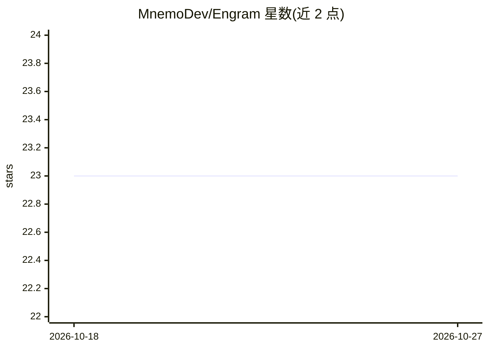

# MnemoDev/Engram

⭐ 23 · TypeScript · MIT · 推送 2026-06-22 · [GitHub](https://github.com/MnemoDev/Engram) · 个人维护

**面向 AI agent 的持久化 RAG 记忆层：存储观察、语义检索、按 TTL 自清理**

为无状态 agent 提供持久记忆服务：通过 POST 写入观察、GET 按语义相似度检索相关上下文。机制包括：以 ChromaDB HNSW 为默认向量库（可用内存后端替代、无需 Docker），余弦相似度 >0.92 的近重复条目合并并刷新过期时间，检索结果按语义相似度 85% + 指数衰减新近度 15% 重排，四类记忆（pattern/warning/outcome/context）各有 TTL 并在查询时过滤与定期批量清理。提供生命周期 hooks、Prometheus 格式 /metrics 端点；运行时为 Bun 1.2，MIT 许可。

## 筛选速览

| 维度 | 判定 | 备注 |
|---|---|---|
| AI 角色 | `ai-ecosystem` | LLM/agent 周边工具 |
| 许可风险 | `permissive` | MIT |
| 部署形态 | `self-host` | docker 或自建部署 |
| 模型依赖 | — | README 未给出锁定关系 |
| 硬件要求 | — | 无带数字的原话,不猜 |
| 安装摩擦 | `low` | 无编译、无系统依赖或容器化 |
| 成熟度 | — | 结构信号不足 |

## 能力要点

- 四类记忆（pattern/warning/outcome/context）分级 TTL 与定期 prune
- 近重复条目按 cosine >0.92 合并而非重复插入
- 检索结果按语义相似度 85% + 新近度 15%（30 天半衰期指数衰减）重排
- 支持 ChromaDB 与免 Docker 的内存后端，提供 Prometheus /metrics

## 适用场景

- 让跨轮次运行的 agent 记住历史观察与执行结果
- 在决策前检索相关历史模式与风险警告
- 为 agent 记忆系统做监控与生命周期管理

## 场景标签

`Agent 记忆` · 领域:Agent 开发

## 证据(README 行号)

> L7: A RAG memory system for AI agents. Store observations, retrieve relevant context by semantic similarity, and let you
> L25: Engram gives agents a persistent memory layer with a simple contract: POST what you observe, GET what's relevant wh

## 星数曲线

2026-10-18 23 → 2026-10-27 23（+0）

---
*卡片 v1 · prompt 1.4 · 生成 2026-10-27 · 置信度 mid · 依据 README sha `a96d00b63571` · [字段定义](../../DATASET.md)*
