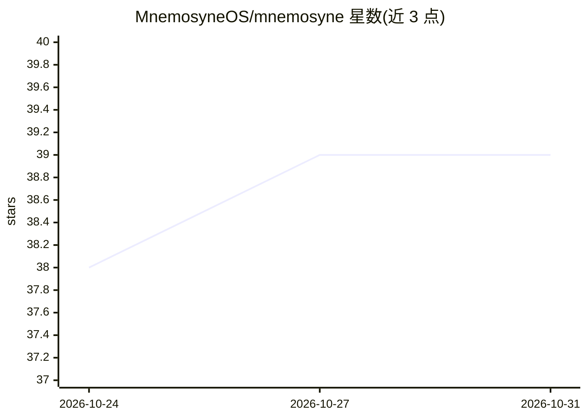

# MnemosyneOS/mnemosyne

⭐ 39 · Python · MIT · 推送 2026-10-30 · [GitHub](https://github.com/MnemosyneOS/mnemosyne) · [官网](https://ai-memory.net) · 组织维护 · 中文 README

**本地优先的 MCP 记忆服务器，供 AI agent 存取长期记忆**

面向 AI agent 的记忆引擎：以 SQLite 文件存储记忆，核心零第三方依赖，内置嵌入器与规则抽取器，无 API key、无模型下载即可离线运行。可作 Python 库、CLI、HTTP API 或 MCP 服务器使用，提供 55 个 MCP 工具（含 11 个 Mem0 兼容工具名）。LLM、嵌入器、向量库、图存储、重排器等组件均按需可选接入，缺省时降级到内置实现并显式声明。另有官方托管 SaaS（ai-memory.net），自托管保持 MIT 且功能不设付费墙。

## 筛选速览

| 维度 | 判定 | 备注 |
|---|---|---|
| AI 角色 | `ai-ecosystem` | LLM/agent 周边工具 |
| 许可风险 | `permissive` | MIT |
| 部署形态 | `library` | 以包/库形式分发 |
| 模型依赖 | local-ok | 支持本地模型 |
| 硬件要求 | — | 无带数字的原话,不猜 |
| 安装摩擦 | `low` | 无编译、无系统依赖或容器化 |
| 成熟度 | — | 结构信号不足 |

## 能力要点

- 核心零第三方依赖，SQLite 单文件存储，离线可用
- 55 个 MCP 工具，含 11 个 Mem0 兼容工具名，可直接切换
- 多信号检索（语义+BM25+实体图+时间+标签）与分级记忆
- LLM/嵌入/向量库/图存储等 20+13+28+6 个适配器均为可选组件

## 适用场景

- 为我的 MCP 客户端（Claude Code、Cursor 等）提供持久记忆后端
- 从 Mem0 迁移且不改动现有提示词与工具定义
- 在本地或内网离线运行 agent 记忆系统，数据不离开自己的磁盘

## 场景标签

`Agent 记忆` · 领域:Agent 开发

## 证据(README 行号)

> L25: **Local-first MCP memory server for AI agents.** Zero third-party
> L263: ## 🛠 MCP server

## 星数曲线

2026-10-24 38 → 2026-10-31 39（+1）

---
*卡片 v1 · prompt 1.4 · 生成 2026-10-25 · 置信度 high · 依据 README sha `246fdf94577e` · [字段定义](../../DATASET.md)*
