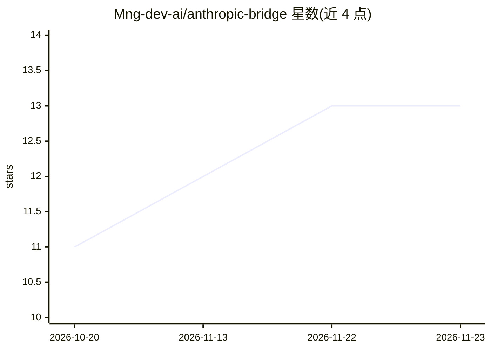

# Mng-dev-ai/anthropic-bridge

⭐ 13 · Python · MIT · 推送 2026-03-29 · [GitHub](https://github.com/Mng-dev-ai/anthropic-bridge) · 个人维护

**Anthropic API 兼容代理，将请求转发至 OpenRouter 等多家 LLM**

基于 Python/FastAPI 的代理服务器，对外暴露 Anthropic Messages API 兼容端点（/v1/messages），内部将请求翻译并路由到 OpenRouter、OpenAI 直连、GitHub Copilot 等上游。支持流式 SSE、工具调用、多轮对话、扩展思考参数映射与 Gemini 推理缓存。通过环境变量配置各 provider，提供 pip 安装与源码开发模式，MIT 许可。

## 筛选速览

| 维度 | 判定 | 备注 |
|---|---|---|
| AI 角色 | `ai-ecosystem` | LLM/agent 周边工具 |
| 许可风险 | `permissive` | MIT |
| 部署形态 | `library` | 以包/库形式分发 |
| 模型依赖 | locked-api |  |
| 硬件要求 | — | 无带数字的原话,不猜 |
| 安装摩擦 | `low` | 无编译、无系统依赖或容器化 |
| 成熟度 | — | 结构信号不足 |

## 能力要点

- Anthropic Messages API 兼容端点，支持流式 SSE 与工具调用
- 按 openai/copilot/openrouter 前缀路由模型，前缀严格不静默重路由
- thinking 参数按 budget_tokens 映射为 low/medium/high/xhigh 推理档位
- Gemini 推理详情缓存与 Grok XML 工具调用解析等 provider 专项处理

## 适用场景

- 让仅支持 Anthropic API 的客户端接入 OpenRouter 上的多家模型
- 在注入令牌的托管环境中统一代理多个 LLM provider
- 复用 Codex CLI 登录态直接调用 OpenAI 模型

## 场景标签

`模型网关` · 领域:Agent 开发

## 证据(README 行号)

> L3: A proxy server that exposes an Anthropic Messages API-compatible endpoint while routing requests to various LLM prov
> L11: - Support for multiple providers: OpenAI, GitHub Copilot, OpenRouter (Gemini, Grok, DeepSeek, Qwen, MiniMax, etc.)
> L100: - `openrouter/*` → OpenRouter API (via `OPENROUTER_API_KEY`)

## 星数曲线

2026-10-20 11 → 2026-11-23 13（+2）

---
*卡片 v1 · prompt 1.4 · 生成 2026-11-18 · 置信度 high · 依据 README sha `6e2731d1270e` · [字段定义](../../DATASET.md)*
