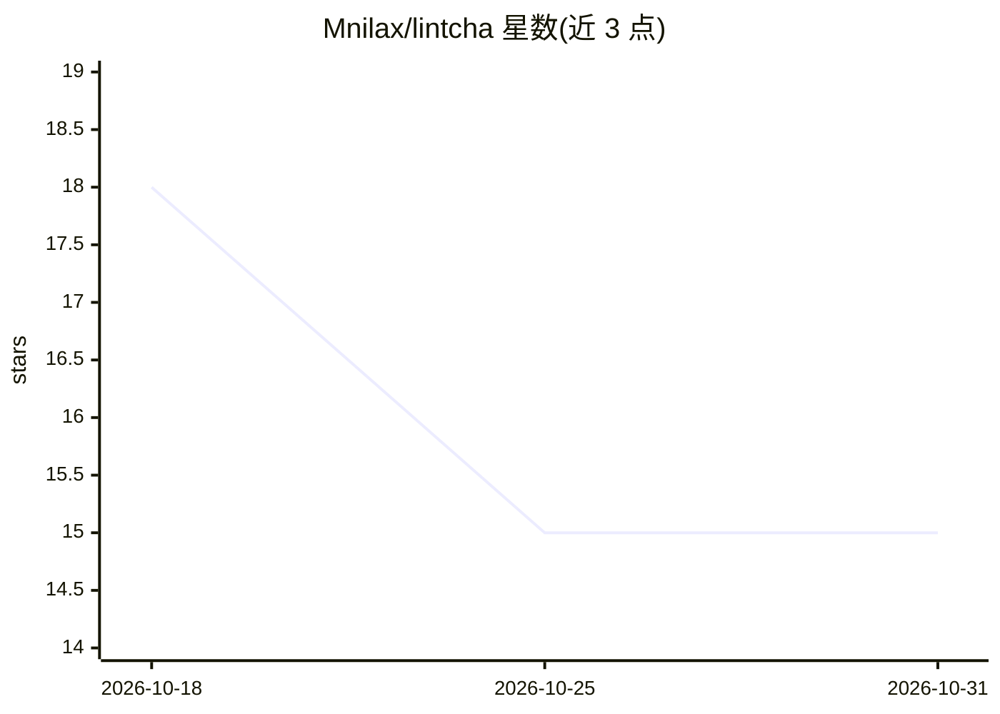

# Mnilax/lintcha

⭐ 15 · HTML · MIT · 推送 2026-09-14 · [GitHub](https://github.com/Mnilax/lintcha) · 个人维护

**在浏览器内检查 AI bot 角色设定文本的八项结构规则缺失情况**

一个纯静态站点：用户粘贴准备放入 AI bot profile 的英文段落，引擎检查八条结构规则（审批、状态记忆、空运行、边界、完成定义、工具列举、密钥泄漏、输入数据处理），对每条返回 met/note/missing 三态，并对缺失项生成可直接粘贴的补全句。全部计算在浏览器本地完成，零外部请求、无上传。附带基于 40 个真实仓库的审计语料与角色库；不评分、不运行 bot，只报告文本说了什么。

## 筛选速览

| 维度 | 判定 | 备注 |
|---|---|---|
| AI 角色 | `ai-ecosystem` | LLM/agent 周边工具 |
| 许可风险 | `permissive` | MIT |
| 部署形态 | `None` |  |
| 模型依赖 | — | README 未给出锁定关系 |
| 硬件要求 | — | 无带数字的原话,不猜 |
| 安装摩擦 | `low` | 无编译、无系统依赖或容器化 |
| 成熟度 | — | 结构信号不足 |

## 能力要点

- 八条规则三态判定（met/note/missing），缺失项给出可粘贴补全句
- 引擎完全在浏览器运行：零外部请求、零 cookie、断网可用
- JS 站点引擎与 Python 审计引擎经 8816 条逐条奇偶校验一致
- 内置八个示例角色，构建时由同一引擎自检

## 适用场景

- 发布 agent 前检查角色设定是否漏写审批/边界/输入处理等条款
- 团队复制粘贴同一份 profile 时发现共同缺失的条款
- 检查 profile 文本中是否携带密钥或 token（R7）

## 场景标签

`提示工程` · 领域:Agent 开发

## 证据(README 行号)

> L20: lintcha reads that paragraph and reports on eight structural properties. It does
> L24: The whole engine runs in your browser. What you paste is never sent anywhere.
> L234: It is not a security product. It does not test a bot, run it, watch it, or

## 星数曲线

2026-10-18 18 → 2026-10-31 15（-3）

---
*卡片 v1 · prompt 1.4 · 生成 2026-10-30 · 置信度 high · 依据 README sha `ef00acf94c5d` · [字段定义](../../DATASET.md)*
