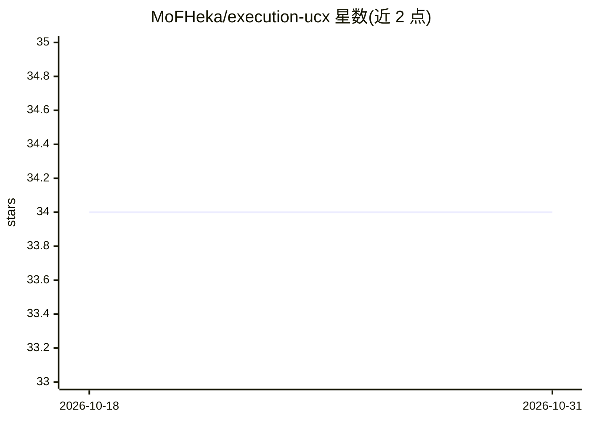

# MoFHeka/execution-ucx

⭐ 34 · C++ · Apache-2.0 · 推送 2026-10-14 · [GitHub](https://github.com/MoFHeka/execution-ucx) · 个人维护

**面向现代 C++ 的 RDMA 通信后端：std::execution 风格的 UCX 运行时与 RPC**

基于 C++26 P2300 std::execution 提案的 OpenUCX 运行时上下文，将控制面与数据面通信统一在 ucx_context 专属工作线程内执行，以避免锁竞争与线程切换。提供 Active Message 零拷贝收发、连接管理、PMR 风格的内存注册（ucx_memory_resource）、CUDA 设备内存与 GPU-Direct RDMA 支持，以及带服务发现的类型安全跨进程 RPC 框架。默认使用 Meta libunifex 实现，可切换 NVIDIA stdexec；用 Bazel 构建，需 OpenUCX v1.18.1+，CUDA Toolkit 为可选依赖。

## 筛选速览

| 维度 | 判定 | 备注 |
|---|---|---|
| AI 角色 | `ai-ecosystem` | LLM/agent 周边工具 |
| 许可风险 | `permissive` | Apache-2.0 |
| 部署形态 | `None` |  |
| 模型依赖 | — | README 未给出锁定关系 |
| 硬件要求 | — | 无带数字的原话,不猜 |
| 安装摩擦 | `medium` | 含编译或系统依赖之一 |
| 成熟度 | — | 结构信号不足 |

## 能力要点

- std::execution 模型的 UCX 异步通信 API（sender 返回值）
- Active Message 零拷贝收发与 rendezvous 两阶段接收
- 类型安全跨进程 RPC 框架（RpcDispatcher）含服务发现
- CUDA 设备内存支持 GPU-Direct RDMA

## 适用场景

- 为 C++ 应用提供异步 RDMA 通信后端
- 构建高性能跨进程 RPC 与服务发现
- GPU 集群上做 GPU-Direct RDMA 数据传输

## 场景标签

 · 领域:高性能计算/分布式通信基础设施

## 证据(README 行号)

> L5: `execution-ucx` is a full-featured OpenUCX runtime context based on the C++26 `P2300` `std::execution` proposal. It 
> L9: Its design goal is to provide an efficient, flexible, and composable asynchronous RDMA communication backend for mod

## 星数曲线

2026-10-18 34 → 2026-10-31 34（+0）

---
*卡片 v1 · prompt 1.4 · 生成 2026-10-25 · 置信度 high · 依据 README sha `cc078f2647d0` · [字段定义](../../DATASET.md)*
