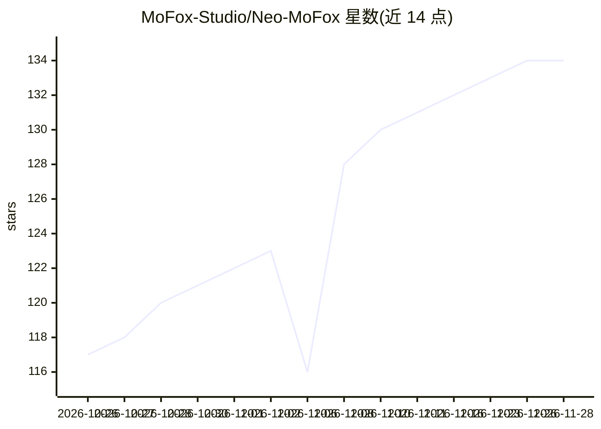

# MoFox-Studio/Neo-MoFox

⭐ 134 · Python · AGPL-3.0 · 推送 2026-11-22 · [GitHub](https://github.com/MoFox-Studio/Neo-MoFox) · 组织维护 · 中文 README

**可插拔的 AI 聊天机器人框架：构建带情感与记忆的数字伙伴**

以 Python 编写的聊天机器人框架，采用万物皆组件的插件化设计，指令、工具、动作、消息适配器均可扩展；内置数据库、向量库、定时任务与缓存接口的 Kernel 层，事件总线覆盖生命周期与会话节点。心智模块负责整理、提取并持久化对话历史，建立人物画像与非结构化情感记忆归档。消息层标准化接入多平台，一套插件可运行于 QQ、Discord 等适配器。部署提供可视化启动器与命令行（uv run）两条路径，WebUI 需另行安装，采用 AGPL-3.0 协议。

## 筛选速览

| 维度 | 判定 | 备注 |
|---|---|---|
| AI 角色 | `ai-ecosystem` | LLM/agent 周边工具 |
| 许可风险 | `viral` | AGPL-3.0 |
| 部署形态 | `None` |  |
| 模型依赖 | — | README 未给出锁定关系 |
| 硬件要求 | — | 无带数字的原话,不猜 |
| 安装摩擦 | `low` | 无编译、无系统依赖或容器化 |
| 成熟度 | — | 结构信号不足 |

## 能力要点

- 插件市场支持下载与自动更新社区插件
- 长短期记忆持久化与情感识别归档机制
- 统一消息结构分发，一套插件适配 QQ、Discord 等平台
- LLM 后端、行为模式、记忆逻辑均可配置

## 适用场景

- 搭建一个有人设与记忆的二次元陪伴机器人
- 为社群接入跨 QQ、Discord 的运营助手
- 在框架上定制专属工作流的 AI 协作者

## 场景标签

`聊天机器人` · 领域:对话与助手

## 证据(README 行号)

> L14: Neo-MoFox 是一个全新重构的 AI 聊天机器人框架，它的目标不仅仅是回答问题，而是为你构筑一个真正的**数字生命体**。我们在架构设计上注入了极高的灵活性，使得这个框架不仅具备情感与记忆机制，还可以完美贴合任何自定义场景的
> L23: - **无缝集成**：可自由拓展以对接不同的大模型或外部工具。
> L26: - **弹性配置**：行为模式、LLM 后端、长短期记忆逻辑等均可层层定义。

## 星数曲线

2026-10-26 117 → 2026-11-28 134（+17）

---
*卡片 v1 · prompt 1.4 · 生成 2026-11-28 · 置信度 high · 依据 README sha `37f4e22217c5` · [字段定义](../../DATASET.md)*
