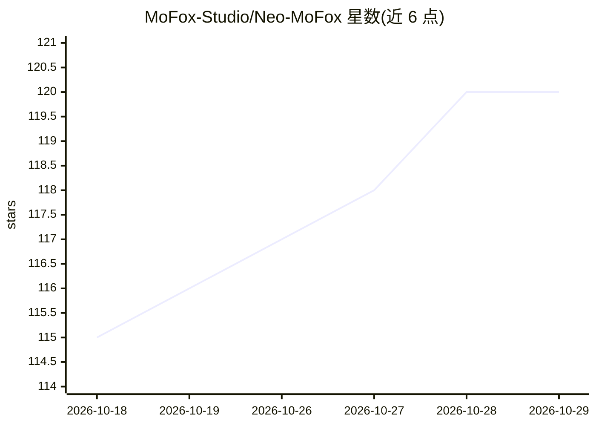

# MoFox-Studio/Neo-MoFox

⭐ 120 · Python · AGPL-3.0 · 推送 2026-10-28 · [GitHub](https://github.com/MoFox-Studio/Neo-MoFox) · 组织维护 · 中文 README

**面向开发者的 AI 聊天机器人框架，带记忆与插件生态**

用 Python 编写的 AI 聊天机器人框架，定位为可自定义的“数字生命体”引擎：指令、工具、消息适配器组件化，提供插件市场下载与自动更新社区插件；支持配置 LLM 后端、长短期记忆、人物画像与情感识别；Kernel 层提供数据库、向量库、定时任务与缓存接口，事件总线覆盖生命周期。跨平台消息接入（QQ、Discord 等）。部署提供可视化启动器或命令行（uv 源码运行），WebUI 需单独安装。

## 筛选速览

| 维度 | 判定 | 备注 |
|---|---|---|
| AI 角色 | `ai-native` | 本体是模型或模型工具 |
| 许可风险 | `viral` | AGPL-3.0 |
| 部署形态 | `None` |  |
| 模型依赖 | — | README 未给出锁定关系 |
| 硬件要求 | — | 无带数字的原话,不猜 |
| 安装摩擦 | `low` | 无编译、无系统依赖或容器化 |
| 成熟度 | — | 结构信号不足 |

## 能力要点

- 组件化插件系统与插件市场（下载/自动更新）
- 人物画像、长短期记忆与情感识别机制
- Kernel 提供数据库、向量库、定时任务调度与缓存接口
- 跨平台消息适配（QQ、Discord 等），一套插件多平台运行

## 适用场景

- 搭建接入 QQ/Discord 等平台的聊天 bot
- 定制具备记忆与情感的 AI 伙伴/社群运营助手
- 通过插件市场扩展 bot 功能

## 场景标签

`Agent 框架` · 领域:Agent 开发

## 证据(README 行号)

> L14: Neo-MoFox 是一个全新重构的 AI 聊天机器人框架，它的目标不仅仅是回答问题，而是为你构筑一个真正的**数字生命体**。我们在架构设计上注入了极高的灵活性，使得这个框架不仅具备情感与记忆机制，还可以完美贴合任何自定义场景的
> L16: 无论你想要打造一个温馨的二次元管家、一个强力的社群运营助手，还是一个具备专属工作流的 AI 协作者，Neo-MoFox 都能成为最坚实的基石。

## 星数曲线

2026-10-18 115 → 2026-10-29 120（+5）

---
*卡片 v1 · prompt 1.4 · 生成 2026-10-23 · 置信度 mid · 依据 README sha `a170d1f8df63` · [字段定义](../../DATASET.md)*
