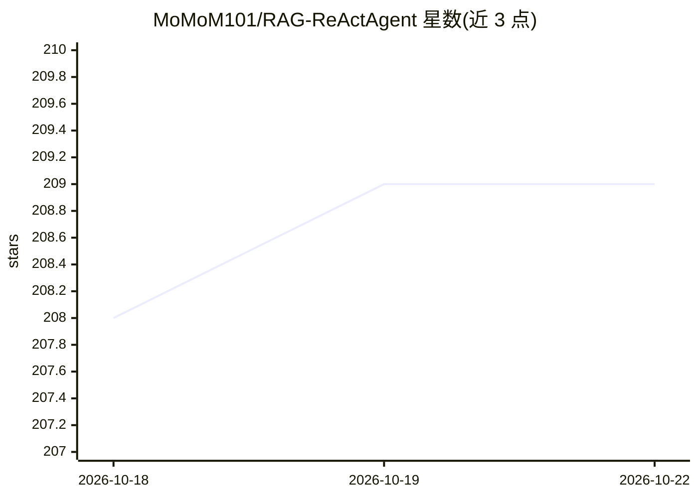

# MoMoM101/RAG-ReActAgent

⭐ 209 · Python · MIT · 推送 2026-10-21 · [GitHub](https://github.com/MoMoM101/RAG-ReActAgent) · [官网](https://github.com/MoMoM101/RAG-ReActAgent#readme) · 个人维护 · 中文 README

**本地优先的 RAG 知识库问答系统，带 ReAct Agent 与引用校验**

用户上传 PDF/Word/文本等文档后，以自然语言提问获得带行内引用与来源卡片的流式回答。系统采用 Qdrant 语义检索与 SQLite BM25 双路混合检索，加权 RRF 融合，可选 Cross-Encoder 精排；自研 ReAct 循环让模型自主选择工具（本地检索、联网搜索、计算器、记忆等）。回答生成后执行引用存在性、位置与数字一致性校验，无证据时拒答。文档入库为可恢复持久任务，数据默认本地保存，JWT 认证。当前 v0.2.1-beta，需自备 OpenAI 兼容 LLM/Embedding 服务；评测指标来自自建合成数据集，非隔离测试。

## 筛选速览

| 维度 | 判定 | 备注 |
|---|---|---|
| AI 角色 | `ai-native` | 本体是模型或模型工具 |
| 许可风险 | `permissive` | MIT |
| 部署形态 | `desktop` | 安装包/桌面程序 |
| 模型依赖 | — | README 未给出锁定关系 |
| 硬件要求 | — | 无带数字的原话,不猜 |
| 安装摩擦 | `low` | 无编译、无系统依赖或容器化 |
| 成熟度 | `idea` | |

## 能力要点

- Qdrant + SQLite BM25 混合检索与加权 RRF 融合，可选 Reranker
- 自研 ReAct 工具循环：模型自主选择与组合工具调用，知识库不足时自动联网搜索
- 回答后验校验：引用存在性、数字一致性、拒答与有界修复
- 文档处理持久任务：重试、死信、重启恢复与索引一致性维护

## 适用场景

- 企业制度、手册与技术文档问答，要求显示来源与引用位置
- 错误码、型号、配置项等精确字段查询
- 多文档对比、内容总结与关键事实抽取
- 文档需本地保存、权限可控的私有知识库部署

## 场景标签

`文档问答` · 领域:知识与检索

## 证据(README 行号)

> L14: RAG Agent 是一个本地优先的文档知识库与智能问答系统。用户上传文档后，可以直接使用自然语言提问；系统会完成意图识别、查询消歧、混合检索、工具调用、证据组织、流式回答和引用校验。
> L16: 它不仅是“上传文档后调用一次大模型”，而是一套覆盖文档入库、检索、生成、校验、持久化、恢复、认证和评测的完整工程链路。

## 星数曲线

2026-10-18 208 → 2026-10-22 209（+1）

---
*卡片 v1 · prompt 1.4 · 生成 2026-10-22 · 置信度 mid · 依据 README sha `756a2ad06323` · [字段定义](../../DATASET.md)*
