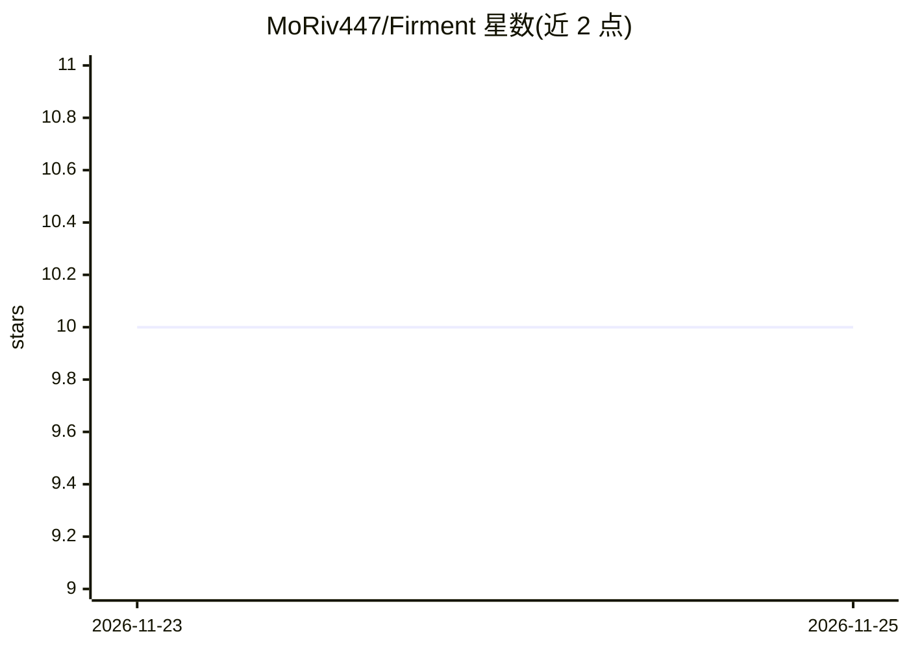

# MoRiv447/Firment

⭐ 10 · Rust · MIT · 推送 2026-11-21 · [GitHub](https://github.com/MoRiv447/Firment) · [官网](https://firment-web.vercel.app) · 个人维护 · 中文 README

**给嵌入式工程师的 AI 固件编码 Agent：写码、烧录、调试一体**

以 Rust 编写的嵌入式固件开发 Agent，单仓库提供 CLI/TUI（ratatui）与 Tauri+React GUI 两个界面，共享同一 Agent 内核。工作流从自然语言需求出发，串联真实工具链的编译（CMake/Make/Keil）、probe-rs 烧录、串口监视、ELF 分析、片上调试与逻辑分析仪观测，并以五级证据阶梯与 verify_command/ELF 回归/HIL 断言等机制判定任务是否真正完成。内置 31 个工具，支持多 Provider 流式工具调用与 Anthropic/OpenAI 兼容接口，MIT 许可。

## 筛选速览

| 维度 | 判定 | 备注 |
|---|---|---|
| AI 角色 | `ai-native` | 本体是模型或模型工具 |
| 许可风险 | `permissive` | MIT |
| 部署形态 | `desktop` | 安装包/桌面程序 |
| 模型依赖 | local-ok | 支持本地模型 |
| 硬件要求 | — | 无带数字的原话,不猜 |
| 安装摩擦 | `medium` | 含编译或系统依赖之一 |
| 成熟度 | — | 结构信号不足 |

## 能力要点

- 31 个内置工具覆盖文件编辑、构建、烧录、串口监视、ELF 分析与片上调试
- 五级验证证据阶梯：编译、烧录、运行输出、物理行为（照片/逻辑分析仪）逐级强制核验
- HIL 硬件在环套件与 redteam 确定性变异测试固件
- 多 Provider 接入：Anthropic 与 OpenAI 兼容接口（含 DeepSeek/GLM/Qwen/Ollama）

## 适用场景

- 让 Agent 完成从写代码到真机烧录验证的固件任务闭环
- 无 OpenOCD/GDB 情况下通过 probe-rs 做片上硬故障诊断
- 用 HIL 套件自动断言串口输出与 LED/波形等物理行为
- 对刚写好的固件做运行时对抗性红队测试

## 场景标签

`编码 Agent` · 领域:编码与开发

## 证据(README 行号)

> L14: **Firment is an AI engineering agent for firmware and embedded development.** Named after *firmament* — the sky abo
> L50: - **Multi-provider**: Anthropic-compatible (`/v1/messages`) and OpenAI-compatible (`/chat/completions`, covering De
> L52: - **Built-in tools** (31 in the registry; `firm tools` prints every name with its schema): `read_file` (line-number

## 星数曲线

2026-11-23 10 → 2026-11-25 10（+0）

---
*卡片 v1 · prompt 1.4 · 生成 2026-11-23 · 置信度 mid · 依据 README sha `989fc3c57e99` · [字段定义](../../DATASET.md)*
